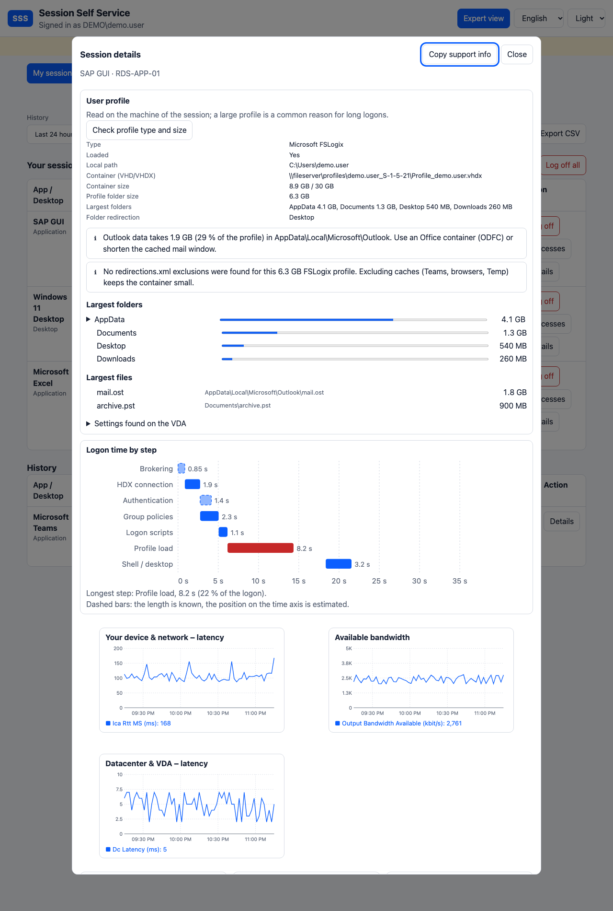
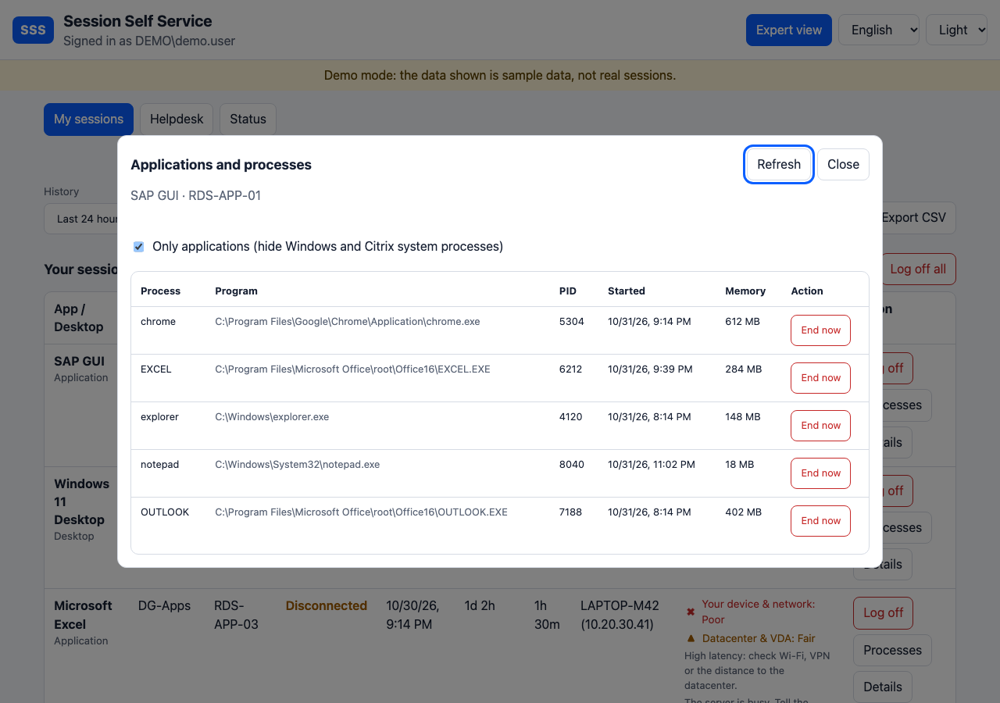

# SSS – Session Self Service

[English version](README.md)

Ein schlankes Web-Portal, mit dem Endanwender einer **Citrix Virtual Apps and Desktops**-Farm (CVAD) **ihre eigenen Sitzungen** sehen und abmelden können – und die von niemand anderem.

> **Status: Beta.** Durchgängig getestet auf Testfarmen mit Citrix Virtual Apps and Desktops **2203, 2402, 2507 und 2607 (LTSR)** (jeweils ein Delivery Controller): Sitzungen, Verlauf, Qualität, Abmelden, Helpdesk-Nachrichten, die Experten-Ansicht mit Anmelde-Wasserfall, die Profilanalyse und das Beenden von Prozessen (über den JEA-Endpunkt) auf einer Testfarm. Mehrere Delivery Controller und mehrere Webserver sind umgesetzt (siehe [docs/MULTI-SERVER.de.md](docs/MULTI-SERVER.de.md)), aber noch nicht in einer echten Umgebung geprüft. Mit dem eingebauten Demo-Modus lässt sich die Oberfläche ohne Citrix ausprobieren.

*Citrix ist eine Marke der Cloud Software Group, Inc. Dieses Projekt ist unabhängig und weder mit ihr verbunden noch von ihr unterstützt.*

<p align="center">
  
  
</p>
<p align="center">
  </p>
<p align="center"></p>
<p align="center"><em>Demo-Modus, hell und dunkel; Experten-Ansicht einer Sitzung</em></p>

## Funktionen

- Zeigt alle **aktiven und getrennten** Sitzungen des angemeldeten Benutzers sowie den **Verlauf** (1 h / 24 h / 7 d / 30 d)
- **Abmelden** mit Bestätigung, dazu die Sammelaktionen „Alle getrennten abmelden“ (nur sichtbar, wenn es welche gibt) und „Alle abmelden“. Einen „Trennen“-Knopf gibt es bewusst nicht
- App/Desktop, Bereitstellungsgruppe, Maschine, Startzeit, Dauer, Inaktivität, Client-Name und -IP
- **Sitzungsqualität** mit Ampel, getrennt nach *Ihr Gerät & Netzwerk* (Latenz, Bandbreite) und *Rechenzentrum & VDA* (Anmeldezeit, Serverlast) – Schwellwerte sind konfigurierbar
- **Anmelde-Wasserfall** und **Profiltyp und Größe** in der Expertenansicht: wohin die Anmeldezeit geht (Brokering, HDX, Gruppenrichtlinien, Skripte, Profil laden, Shell) und ob das Profil lokal, servergespeichert, Citrix UPM oder FSLogix ist, wie groß es ist und welche Ordner am größten sind
- **Anwendungen und Prozesse** einer Sitzung: ansehen und eine hängende Anwendung schließen oder beenden, für Benutzer (eigene Sitzungen) und Helpdesk, über einen eingeschränkten JEA-Endpunkt auf den VDAs (standardmäßig aus, siehe [docs/PROCESSES.de.md](docs/PROCESSES.de.md))
- Filter, Sortierung, CSV-Export (mit Schutz vor Formel-Injection in Tabellenkalkulationen)
- Audit-Log (wer hat wann von wo welche Sitzung abgemeldet) als JSON-Lines
- **Helpdesk** für eine AD-Gruppe: Benutzer finden, alle aktiven Sitzungen der Farm sehen, fremde Sitzungen mit Grund abmelden, **Nachricht an eine Sitzung senden**, die Experten-Ansicht jeder Sitzung öffnen, lückenlos protokolliert
- **Statusseite** für den Helpdesk: Live-Prüfungen (Broker, Monitor, Dienstkonto, Audit-Ordner, HTTPS) statt Suche in der Ereignisanzeige
- Optionaler **StoreFront-Link** (`Sss:StoreFrontUrl`), um Sitzungen zu starten oder wiederzuverbinden
- **Experten-Ansicht** (Schalter im Kopf): alles, was Citrix zu einer Sitzung gesammelt hat, ähnlich den Detailseiten des Directors, gruppiert in Sitzung, Anmeldung (mit den einzelnen Anmeldeschritten), Client & Verbindung, letzte Messung, Server (VDA) und technische IDs; **Diagramme im Zeitverlauf** für ICA-Round-Trip-Zeit, Bandbreite und Rechenzentrums-Latenz; Verbindungsverlauf und Fehler-/Trennungsgründe; ein Knopf **„Support-Info kopieren“** legt die wichtigsten Fakten für ein Ticket in die Zwischenablage. Die Standard-Ansicht bleibt kurz: die zwei Ampeln plus ein Hinweis, wenn etwas auffällt
- Responsive, Dark Mode, bedienbar per Tastatur und Screenreader (Ampeln verlassen sich nie nur auf Farbe)
- Sprachen: English, Deutsch, Français, Español, 中文

## Sicherheitsmodell

- Die Benutzeridentität stammt **ausschließlich** aus der Windows-Authentifizierung des IIS. Sie wird nie aus Request-Parametern gelesen.
- Jedes Abmelden wird serverseitig gegen die eigenen aktiven Sitzungen des Aufrufers geprüft, bevor etwas an Citrix geht. Fremde oder unbekannte Sitzungs-IDs werden abgelehnt und protokolliert.
- Anti-Forgery-Token bei allen POST-Anfragen, Rate-Limiting pro Benutzer bei Abmeldungen, strenge CSP und weitere Security-Header, keine Inline-Skripte, kein `innerHTML`.
- Der „Dev“-Authentifizierungsmodus startet nur mit `ASPNETCORE_ENVIRONMENT=Development`.
- Details und Meldewege: [SECURITY.md](SECURITY.md)

## Architektur

```
Browser (statische SPA) → IIS (Windows-Auth) → ASP.NET Core (In-Process)
                                                 └─ ISessionProvider
                                                      ├─ MockSessionProvider      (Demo, Tests)
                                                      └─ CitrixSessionProvider: Broker-SDK (PowerShell-Worker) + Monitor-OData
```

ASP.NET Core auf .NET 10, In-Process im IIS gehostet (kein zusätzlicher Prozess, kein Kaltstart mit *AlwaysRunning* und ohne Idle-Timeout), self-contained veröffentlicht, sodass auf dem Server keine Runtime installiert sein muss.

## Lokal ausprobieren (macOS, Linux, Windows)

Voraussetzung: [.NET 10 SDK](https://dotnet.microsoft.com/download).

```bash
ASPNETCORE_ENVIRONMENT=Development ASPNETCORE_URLS=http://localhost:5080 dotnet run --project src/Sss.Web
```

<http://localhost:5080> öffnen. In der Entwicklung werden ein fester Demo-Benutzer und Beispieldaten verwendet.

```bash
dotnet test
```

## Dienstkonto vorbereiten (gMSA)

SSS sollte unter einem **Group Managed Service Account (gMSA)** laufen: einem Active-Directory-Konto für Dienste, dessen Passwort Windows selbst erzeugt und regelmäßig wechselt. Niemand kennt oder tippt es, man kann sich damit nicht interaktiv anmelden, und es läuft nie ab. Erkennbar ist es am `$` am Ende, zum Beispiel `CORP\svc-sss$`. Mit diesem Konto spricht SSS mit dem Delivery Controller, es braucht also genau die Citrix-Rechte, die SSS benötigt, und nicht mehr.

**1. gMSA anlegen** (Domain-Admin; AD-PowerShell-Modul):

```powershell
# einmal pro Domäne, nur falls noch kein KDS-Root-Key existiert (im Lab sofort wirksam):
Add-KdsRootKey -EffectiveTime ((Get-Date).AddHours(-10))

# 'IIS-SERVER$' = Computerkonto des Servers, auf dem SSS läuft (oder eine Sicherheitsgruppe solcher Server)
New-ADServiceAccount -Name svc-sss -DNSHostName svc-sss.corp.local `
  -PrincipalsAllowedToRetrieveManagedPassword 'IIS-SERVER$'
```

**2. Auf dem IIS-Server installieren und testen** (PowerShell als Administrator; braucht das AD-Modul / RSAT):

```powershell
Install-ADServiceAccount svc-sss
Test-ADServiceAccount svc-sss      # muss True liefern
```

**3. Citrix-Rolle zuweisen.** Der Kontenauswahldialog von Citrix Studio listet gMSAs meist nicht auf. Lege den Administrator deshalb per PowerShell auf einem Delivery Controller an (PowerShell als Administrator). Das ist der empfohlene Weg:

```powershell
Add-PSSnapin Citrix.DelegatedAdmin.Admin.V1
New-AdminAdministrator -Name 'CORP\svc-sss$' -Enabled $true
Add-AdminRight -Administrator 'CORP\svc-sss$' -Role 'Help Desk Administrator' -All
Get-AdminAdministrator | Select-Object Name, Enabled, @{n='Rights';e={ @($_.Rights).Count }}   # Rights muss 1 oder mehr sein
```

`New-AdminAdministrator` allein legt einen Administrator **ohne Rechte** an (`Rights : {}`) – `Add-AdminRight` ist nötig. Die eingebaute Rolle **Help Desk Administrator** darf Sitzungen lesen, abmelden und Monitor-Daten lesen; lege eine engere eigene Rolle an, sobald du weißt, was du brauchst (siehe [SECURITY.md](SECURITY.md)). Danach den App-Pool von SSS neu starten.

*Alternative über eine AD-Gruppe:* `svc-sss$` in eine Sicherheitsgruppe aufnehmen und diese Gruppe in Studio hinzufügen. Das funktioniert, aber ein laufender App-Pool behält das Token, mit dem er gestartet wurde. Eine Änderung der Gruppenmitgliedschaft wirkt daher eventuell erst nach einem vollständigen Neustart des App-Pools (manchmal erst nach einem Neustart des Servers). Der direkte Eintrag oben vermeidet das Problem.

**4. Dem Installer übergeben** mit `-ServiceAccount 'CORP\svc-sss$'` (einfache Anführungszeichen, sonst expandiert PowerShell das `$`). Der Installer setzt es als Identität des App-Pools und gibt ihm Leserechte auf die Anwendung und Schreibrechte auf den Audit-Log-Ordner.

Ohne `-ServiceAccount` läuft der App-Pool als `ApplicationPoolIdentity`. Das meldet sich an anderen Servern als Computerkonto an und hat keine Citrix-Rechte – genug, um die Oberfläche anzusehen, aber nicht für den echten Betrieb. Der Installer unterstützt nur gMSAs (er setzt ein leeres App-Pool-Passwort).

## Installation auf dem IIS (Windows Server)

Voraussetzungen auf dem Server: IIS mit dem [.NET Hosting Bundle](https://dotnet.microsoft.com/download/dotnet) (für das ASP.NET Core Module; SSS selbst ist self-contained), die Citrix-PowerShell-Snap-ins (oder das Remote PowerShell SDK) und ein [Group Managed Service Account](#dienstkonto-vorbereiten-gmsa) mit einer Citrix-Rolle.

1. `sss-<version>-win-x64.zip` von den [Releases](../../releases) laden und auf dem Server entpacken (bei privatem Repository auf einem angemeldeten Rechner mit `gh release download` laden und hinüberkopieren).
2. In einer Windows PowerShell mit Administratorrechten:

```powershell
.\install.ps1 -Interactive            # fragt Controller, Dienstkonto und Helpdesk-Gruppe ab
.\install.ps1 -Controllers ddc01.corp.local,ddc02.corp.local -ServiceAccount 'CORP\svc-sss$'
```

3. Verdrahtung prüfen: `.\Test-SssSetup.ps1`. Das Skript ist schreibgeschützt und nennt zu jedem Befund den genauen Befehl zur Behebung (IIS, App-Pool, gMSA, Citrix-Administratoreintrag, Helpdesk-Gruppe, Berechtigungen, die Anwendung selbst). Welches Konto welches Recht braucht, steht in [Berechtigungen auf einen Blick](docs/PERMISSIONS.de.md).


Standardmäßig wird SSS zur Anwendung `Default Web Site/sss` und liegt auf einem Web-Studio-Server damit neben Studio. Mit `-SiteName`, `-AppPath` und `-PhysicalPath` lässt sich das ändern, mit `-WhatIf` eine Vorschau anzeigen. Das Skript legt einen eigenen App-Pool an (kein Managed Code, *AlwaysRunning*, kein Idle-Timeout, kein periodisches Recycling), aktiviert die Windows-Authentifizierung, deaktiviert den anonymen Zugriff, setzt Berechtigungen, schreibt eine Start-`sss.config.json` (wird bei Updates behalten) und führt einen Smoke-Test aus. Ein Update geht mit `.\install.ps1 -Update`: Es werden nur die Dateien ersetzt (Konfiguration, App-Pool und Berechtigungen bleiben), die vorige Version bleibt in `<Installationsordner>.previous` erhalten und wird bei einem fehlgeschlagenen Smoke-Test automatisch wiederhergestellt. Die Seite ist kurz über `app_offline.htm` offline. `-Uninstall` entfernt Anwendung und App-Pool, behält aber Dateien, Konfiguration und Audit-Logs.

Release-Builds entstehen durch einen Tag wie `v0.1.0`; das Zip enthält eine Prüfsummen-Datei (`.sha256`).

## Konfiguration

Die Standardwerte stehen in `src/Sss.Web/appsettings.json`. Überschreiben lassen sie sich in einer Datei `sss.config.json` neben der Anwendung (Abschnitt `Sss`), zum Beispiel:

```json
{
  "Sss": {
    "RefreshSeconds": 30,
    "RateLimit": { "LogoffRequestsPerMinute": 10 },
    "Quality": { "RttWarnMs": 80, "RttCritMs": 150 }
  }
}
```

Nach Änderungen ist ein Neustart (Recycling des App-Pools) nötig.

## Anbindung an eine echte Citrix-Farm

`Sss:Provider` in der `sss.config.json` auf `Citrix` setzen:

```json
{
  "Sss": {
    "Provider": "Citrix",
    "Citrix": {
      "Controllers": [ "ddc01.corp.local", "ddc02.corp.local" ],
      "Workers": 2,
      "Monitor": { "BaseUrl": "https://ddc01.corp.local/Citrix/Monitor/OData/v4/Data/" }
    }
  }
}
```

- **Live-Sitzungen und Abmelden** laufen über das Broker-SDK in vorgewärmten Windows-PowerShell-5.1-Workern. Der Server braucht die Citrix-PowerShell-Snap-ins (kommen mit Studio/Web Studio) oder das *Remote PowerShell SDK*, wenn SSS auf einem separaten Server läuft.
- **Verlauf und Qualität** kommen aus der Monitor-OData-API. Ist sie nicht erreichbar, zeigt die Oberfläche einen Hinweis und alles andere funktioniert weiter.
- Die Identität des App-Pools (am besten ein gMSA) braucht eine delegierte Citrix-Administratorrolle, die Sitzungen lesen, abmelden und Monitor-Daten lesen darf (z. B. eine eigene Rolle auf Basis von *Help Desk Administrator*).
- Vor dem ersten Einsatz auf dem Server `scripts/Test-SssCitrix.ps1` ausführen. Es liest nur und prüft Erreichbarkeit und die genauen OData-Feldnamen. Aufruf: `.\Test-SssCitrix.ps1 -Controller ddc01 -UserName CORP\alice` (der Benutzername muss `DOMAIN\username` lauten), während der Benutzer eine Sitzung hat. Auf CVAD 2507 CU1 geprüft: Alle von SSS verwendeten Monitor-Felder existieren; die Bandbreite wird aus `SessionMetrics.OutputBandwidthAvailable` (bit/s) bewertet. Der Monitor wird standardmäßig über `https://` angesprochen; für einen Controller ohne HTTPS-Bindung `Citrix:Monitor:UseHttps` auf `false` setzen oder die volle Adresse in `Citrix:Monitor:BaseUrl` angeben. Vor dem Posten der Ausgabe von `Test-SssSetup.ps1` oder `Test-SssCitrix.ps1` in einem öffentlichen Issue `-Redact` anhängen: Es ersetzt Benutzer, Domäne, Hostnamen, SIDs, IP-Adressen und GUIDs (`-Mask wort1,wort2` ergänzt weitere).
- „Abmelden“ startet den Vorgang (`Stop-BrokerSession` arbeitet asynchron); die Sitzung verschwindet nach wenigen Sekunden aus der Liste.

## Helpdesk

Mitglieder einer AD-Gruppe können Benutzer finden und **deren** Sitzungen sehen und abmelden. Alle anderen bekommen bei allen Helpdesk-Endpunkten HTTP 403 und sehen den Reiter nie.

1. Eine Sicherheitsgruppe anlegen, z. B. `SSS-Helpdesk`, und die Helpdesk-Mitarbeiter aufnehmen: `New-ADGroup -Name SSS-Helpdesk -GroupScope Global -GroupCategory Security`.
2. Die Gruppe in die `sss.config.json` eintragen (oder bei einer Neuinstallation `-HelpdeskGroup 'CORP\SSS-Helpdesk'` an `install.ps1` übergeben) und den App-Pool recyceln:

```json
{ "Sss": { "Helpdesk": { "Group": "CORP\\SSS-Helpdesk", "ReasonRequired": false, "MaxSessions": 1000 } } }
```

3. Helpdesk-Mitarbeiter müssen sich nach der Aufnahme in die Gruppe neu anmelden, weil Gruppenmitgliedschaften im Windows-Anmeldetoken stehen.

Im Reiter **Helpdesk** suchst du nach einem Namensteil (Benutzer mit aktiver Sitzung aus dem Broker, Benutzer nur mit Verlauf aus Monitor) oder wählst einen Benutzer aus der Liste **aller aktiven Sitzungen** der Farm (filterbar, begrenzt auf `MaxSessions`). Beim Öffnen eines Benutzers siehst du dieselben Tabellen wie er selbst, mit denselben Abmelden-Knöpfen und einem optionalen **Grund**. Mit `ReasonRequired` wird der Grund zur Pflicht.

Alles, was der Helpdesk tut, steht im Audit-Log mit handelndem Benutzer, betroffenem Benutzer und Grund: Suchen, das Öffnen eines Benutzers (höchstens einmal pro 5 Minuten und Benutzer), die Farm-Übersicht und jedes Abmelden. Helpdesk-Anfragen sind ratenbegrenzt (60/min). Der Helpdesk nutzt dasselbe Dienstkonto und dieselbe Citrix-Rolle wie das Self-Service, es sind keine zusätzlichen Citrix-Rechte nötig. Wer Zugriff auf den Helpdesk hat, sieht die Sitzungen aller Benutzer: Die Gruppe klein halten.

## Fehlersuche

Als erstes: den Reiter **Status** öffnen (Helpdesk) oder `Test-SssSetup.ps1` ausführen. Beide prüfen dasselbe und nennen die fehlschlagende Stelle.

| Symptom | Ursache und Lösung |
|---|---|
| Seite lädt, zeigt aber „Der Dienst ist vorübergehend nicht verfügbar“ (HTTP 503) | In die Windows-Ereignisanzeige schauen (*Anwendung*, Quelle `.NET Runtime`, Text `An unhandled exception has occurred`). `Insufficient administrative privilege` bedeutet: Die Identität des App-Pools ist kein Citrix-Administrator, oder Rolle/Bereich erlauben das Lesen von Sitzungen nicht. Das gMSA in Studio unter *Administratoren* mit z. B. der Rolle *Help Desk Administrator* und dem Bereich *Alle* anlegen. |
| `Insufficient administrative privilege`, obwohl das Recht existiert (läuft als geplanter Task unter dem gMSA, scheitert im IIS) | Der laufende App-Pool hat noch ein altes Token, typischerweise nach einer Änderung der Gruppenmitgliedschaft. Das gMSA direkt als Citrix-Administrator mit Rolle eintragen (siehe Schritt 3) und den App-Pool vollständig neu starten. |
| „Something went wrong“ direkt nach dem Laden | Der Browser erreicht die API nicht. Die Seite über die exakte URL mit `/sss/` am Ende öffnen und im Netzwerk-Tab nachsehen. |
| Verlauf oder Qualität fehlen, Hinweis wird angezeigt | Der Monitor-OData-Dienst ist nicht erreichbar oder das Konto darf ihn nicht lesen; `Test-SssCitrix.ps1` ausführen. |
| `Test-SssCitrix.ps1` meldet „UserName must be in the format DOMAIN\username“ | Den Benutzer als `CORP\alice` übergeben. |

## Roadmap

- [x] Citrix-Provider: Live-Sitzungen und Abmelden über das Broker-SDK (vorgewärmte Windows-PowerShell-5.1-Worker), Verlauf über Monitor-OData
- [x] Auf CVAD 2507 CU1 verifiziert (ein Delivery Controller)
- [x] Auf CVAD 2203, 2402, 2507 und 2607 getestet
- [ ] Setups mit mehreren Controllern und Servern in einer echten Umgebung prüfen (getrennte Delivery Controller, StoreFront, Web Studio)
- [x] Helpdesk-Rolle (AD-Gruppe): Suche, Farm-Übersicht, Abmelden mit Grund, Nachricht an eine Sitzung, Audit
- [x] IIS-Installationsskript (App-Pool, Berechtigungen, Windows-Authentifizierung)
- [x] Experten-Ansicht mit Diagrammen, Anmelde-Wasserfall, Profilanalyse, Support-Info, StoreFront-Link, Statusseite, Setup-Prüfung
- [x] Einzelne Prozesse einer Sitzung beenden (JEA-Endpunkt auf den VDAs)
- [ ] Freundliches „Schließen“ einer Anwendung (braucht einen Helfer in der Sitzung des Benutzers)
- [ ] Engere eigene Citrix-Rolle für das Dienstkonto
- [ ] Citrix-Cloud-Backend (DaaS)
- [x] Release-Builds über GitHub Actions

## Dokumentation

- [Berechtigungen auf einen Blick](docs/PERMISSIONS.de.md): wer braucht welches Recht, wo und warum, mit Befehlen zum Kopieren
- [Konfigurationsreferenz](docs/CONFIGURATION.de.md): jede Option mit Standardwert und Bedeutung
- [Voraussetzungen](docs/REQUIREMENTS.de.md): Software, Konten, Citrix, Ports
- [Betrieb](docs/OPERATIONS.de.md): Update, Health-Probe, Status-Seite, Audit-Protokoll, Fehlersuche
- [Anwendungen und Prozesse](docs/PROCESSES.de.md): JEA-Endpunkt, Einrichtung, Sicherheit
- [Versionierung und Kompatibilität](docs/COMPATIBILITY.de.md): was stabil ist, wie du aktualisierst; [Changelog](CHANGELOG.md)
- [Bedrohungsanalyse](docs/THREAT-MODEL.de.md): was SSS schützt, wer es angreifen könnte, was ihn aufhält
- [Mehrere Controller und Server](docs/MULTI-SERVER.de.md): Failover, Load Balancer, Kerberos-Alias, gemeinsamer Schlüsselring, Audit, Monitor über HTTPS
- [Datenquellen](docs/DATA-SOURCES.de.md): woher Sitzungsdaten und Qualitätswerte kommen und wie sie bewertet werden
- [Architektur](docs/ARCHITECTURE.de.md): Bausteine, Abläufe, Konfigurationsreferenz
- [Sicherheit](SECURITY.md): Sicherheitsmodell, Betreiber-Checkliste, Meldewege

## Lizenz

[Apache License 2.0](LICENSE)
