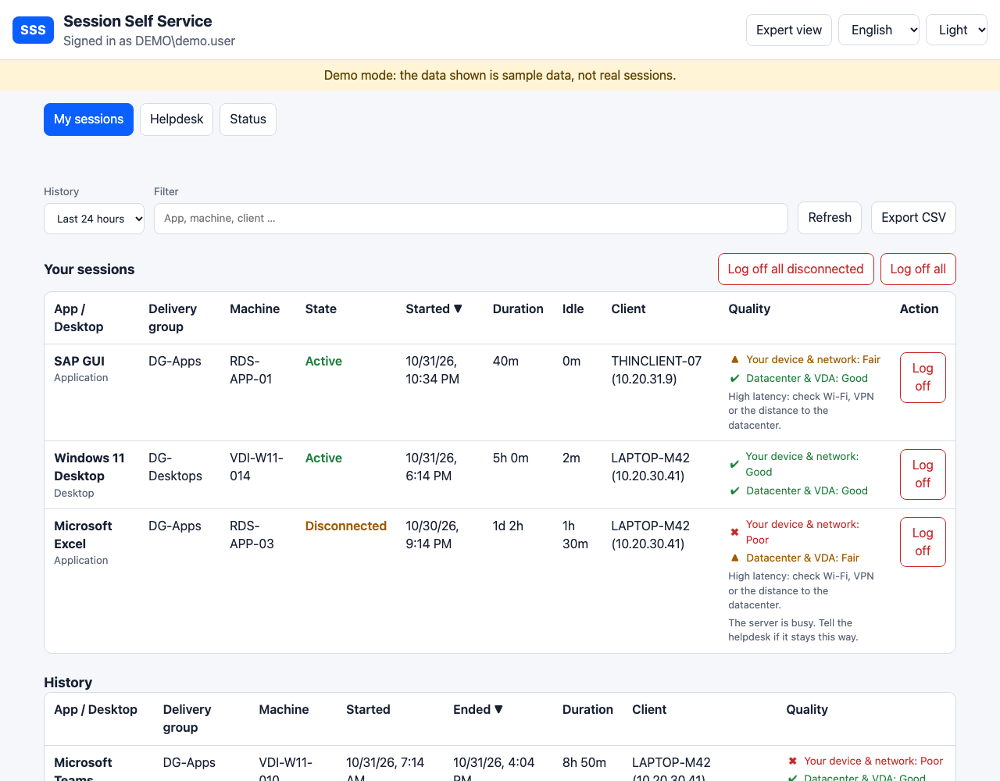
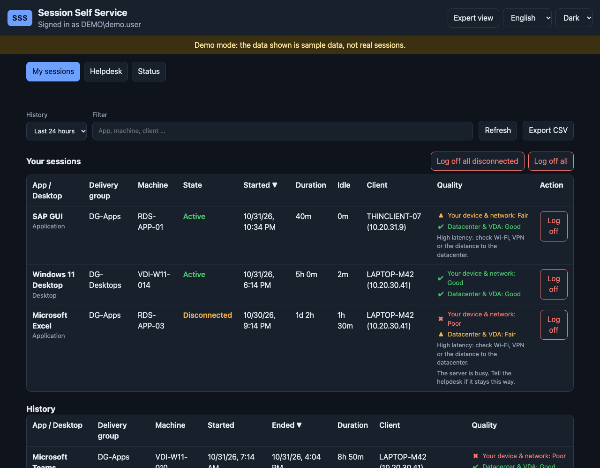
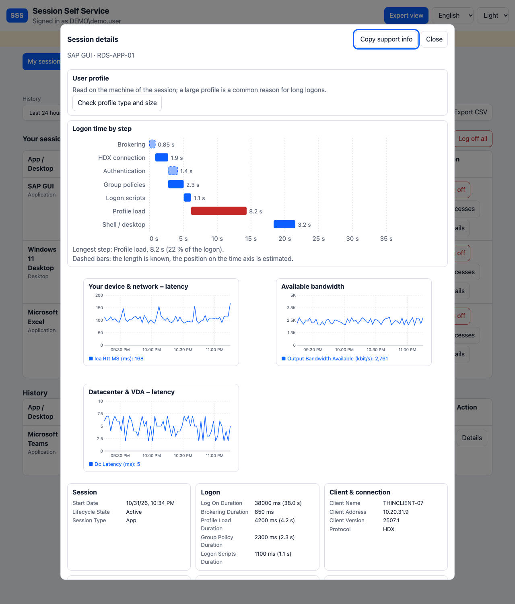

# SSS – Session Self Service

[Deutsche Version](README.de.md)

A lightweight web portal that lets end users of a **Citrix Virtual Apps and Desktops** (CVAD) site see and log off **their own sessions** – and nobody else's.

> **Status: early development.** Tested end to end on Citrix Virtual Apps and Desktops **2203, 2402, 2507 and 2607 (LTSR)** test sites (single Delivery Controller): sessions, history, quality and log-off through IIS. Several Delivery Controllers and several web servers are implemented (see [docs/MULTI-SERVER.md](docs/MULTI-SERVER.md)) but not yet verified on a real site. Built-in demo mode lets you try the UI without Citrix.

*Citrix is a trademark of Cloud Software Group, Inc. This project is independent and not affiliated with or endorsed by it.*

<p align="center">
  
  
</p>
<p align="center"></p>
<p align="center"><em>Demo mode, light and dark; expert view of a session</em></p>

## Features

- Shows all **active and disconnected** sessions of the signed-in user, plus **history** (1 h / 24 h / 7 d / 30 d)
- **Log off** with confirmation, plus bulk actions "Log off all disconnected" (only visible if there are any) and "Log off all". There is intentionally no "Disconnect" button
- App/desktop, delivery group, machine, start time, duration, idle time, client name and IP
- **Session quality** with a traffic light, separated into *your device & network* (latency, bandwidth) and *datacenter & VDA* (logon time, server load) – thresholds are configurable
- **Expert view** (toggle in the header): everything Citrix collected about a session, like Director's detail pages, grouped into session, logon (with the logon steps), client & connection, latest measurement, server (VDA) and technical ids; **charts over time** for ICA round-trip time, bandwidth and datacenter latency; connection history and failure/disconnect reasons; a **"Copy support info"** button that puts the key facts into the clipboard for a ticket. The standard view stays short: the two traffic lights plus a one-line hint when something is off
- Filter, sorting, CSV export (protected against spreadsheet formula injection)
- Audit log (who logged off which session, when, from where) as JSON lines
- **Helpdesk** for an AD group: find users, see all live sessions of the farm, log off other users' sessions with a reason, **send a message** to a session, open the expert view of any session, fully audited
- **Status page** for the helpdesk: live health checks (Broker, Monitor, service account, audit log folder, HTTPS) instead of digging through event logs
- Optional **StoreFront link** (`Sss:StoreFrontUrl`) to start or reconnect sessions
- Responsive layout, dark mode, keyboard and screen-reader friendly (traffic lights never rely on colour alone)
- Languages: English, Deutsch, Français, Español, 中文

## Security model

- The user identity comes **only** from IIS Windows authentication on the server. It is never read from request parameters.
- Every log-off is re-checked server-side against the caller's own live sessions before anything is sent to Citrix. Foreign or unknown session IDs are rejected and audited.
- Anti-forgery token on all POST requests, per-user rate limiting on log-off actions, strict CSP and other security headers, no inline scripts, no `innerHTML`.
- The mock "Dev" authentication mode refuses to start unless `ASPNETCORE_ENVIRONMENT=Development`.
- Details and reporting: [SECURITY.md](SECURITY.md)

## Architecture

```
Browser (static SPA) → IIS (Windows auth) → ASP.NET Core (in-process)
                                              └─ ISessionProvider
                                                   ├─ MockSessionProvider      (demo, tests)
                                                   └─ CitrixSessionProvider: Broker SDK (PowerShell workers) + Monitor OData
```

ASP.NET Core on .NET 10, hosted in-process in IIS (no extra process, no cold start with *AlwaysRunning* and no idle timeout), published self-contained so the server needs no runtime installation.

## Try it locally (macOS, Linux, Windows)

Requires the [.NET 10 SDK](https://dotnet.microsoft.com/download).

```bash
ASPNETCORE_ENVIRONMENT=Development ASPNETCORE_URLS=http://localhost:5080 dotnet run --project src/Sss.Web
```

Open <http://localhost:5080>. In development a fixed demo user and sample data are used.

```bash
dotnet test
```

## Prepare the service account (gMSA)

SSS should run under a **group managed service account (gMSA)**: an Active Directory account for services whose password is generated and rotated by Windows itself. Nobody knows or types it, it cannot be used for interactive logons and it never expires. It is recognisable by the trailing `$`, for example `CORP\svc-sss$`. The account is what SSS uses to talk to the Delivery Controller, so it needs exactly the Citrix rights SSS requires and nothing else.

**1. Create the gMSA** (Domain Admin; AD PowerShell module):

```powershell
# once per domain, only if no KDS root key exists yet (effective immediately in a lab):
Add-KdsRootKey -EffectiveTime ((Get-Date).AddHours(-10))

# 'IIS-SERVER$' = computer account of the server that runs SSS (or a security group of such servers)
New-ADServiceAccount -Name svc-sss -DNSHostName svc-sss.corp.local `
  -PrincipalsAllowedToRetrieveManagedPassword 'IIS-SERVER$'
```

**2. Install and test it on the IIS server** (elevated PowerShell; needs the AD module / RSAT):

```powershell
Install-ADServiceAccount svc-sss
Test-ADServiceAccount svc-sss      # must return True
```

**3. Give it a Citrix role.** Citrix Studio's account picker usually does not list gMSAs, so create the administrator with PowerShell on a Delivery Controller (elevated PowerShell). This is the recommended way:

```powershell
Add-PSSnapin Citrix.DelegatedAdmin.Admin.V1
New-AdminAdministrator -Name 'CORP\svc-sss$' -Enabled $true
Add-AdminRight -Administrator 'CORP\svc-sss$' -Role 'Help Desk Administrator' -All
Get-AdminAdministrator | Select-Object Name, Enabled, @{n='Rights';e={ @($_.Rights).Count }}   # Rights must be 1 or more
```

`New-AdminAdministrator` alone creates an administrator **without any rights** (`Rights : {}`) – `Add-AdminRight` is required. The built-in **Help Desk Administrator** role may read sessions, log them off and read Monitor data; create a stricter custom role once you know what you need (see [SECURITY.md](SECURITY.md)). Afterwards restart the SSS app pool.

*Alternative via an AD group:* add `svc-sss$` to a security group and add that group in Studio. This works, but a running app pool keeps the token it was started with, so a membership change may only take effect after a full restart of the app pool (sometimes after a reboot). The direct entry above avoids that problem.

**4. Pass it to the installer** with `-ServiceAccount 'CORP\svc-sss$'` (single quotes, otherwise PowerShell expands the `$`). The installer sets it as the app pool identity and grants it read access to the application and write access to the audit log folder.

Without `-ServiceAccount` the app pool runs as `ApplicationPoolIdentity`, which authenticates to other servers as the computer account and has no Citrix rights – fine for a first look at the UI, not for real use. Only gMSAs are supported by the installer (it sets an empty app pool password).

## Install on IIS (Windows Server)

Prerequisites on the server: IIS with the [.NET Hosting Bundle](https://dotnet.microsoft.com/download/dotnet) (for the ASP.NET Core Module; SSS itself is self-contained), the Citrix PowerShell snap-ins (or the Remote PowerShell SDK), and a [group-managed service account](#prepare-the-service-account-gmsa) with a Citrix role.

1. Download `sss-<version>-win-x64.zip` from the [releases](../../releases) and extract it on the server (for a private repository, download it with `gh release download` on a machine that is signed in and copy it over).
2. In an elevated Windows PowerShell:

```powershell
.\install.ps1 -Interactive            # asks for controllers, service account, helpdesk group
.\install.ps1 -Controllers ddc01.corp.local,ddc02.corp.local -ServiceAccount 'CORP\svc-sss$'   # or non-interactive
```

3. Check the wiring: `.\Test-SssSetup.ps1`. It is read-only and prints the exact command that fixes each finding (IIS, app pool, gMSA, Citrix administrator entry, helpdesk group, permissions, the application itself). Which account needs which permission is summarised in [Permissions at a glance](docs/PERMISSIONS.md).

By default SSS becomes the application `Default Web Site/sss`, so on a Web Studio server it lives next to Studio. Use `-SiteName`, `-AppPath`, `-PhysicalPath` to change that and `-WhatIf` to preview. The script creates a dedicated app pool (no managed code, *AlwaysRunning*, no idle timeout, no periodic recycle), enables Windows authentication, disables anonymous access, sets permissions, writes a starter `sss.config.json` (kept on updates) and runs a smoke test. Update with `.\install.ps1 -Update`: only the files are replaced (configuration, app pool and permissions stay as they are), the previous version is kept in `<install folder>.previous`, and it is restored automatically if the smoke test fails. The site goes briefly offline via `app_offline.htm`. `-Uninstall` removes the application and app pool but keeps files, configuration and audit logs.

Release builds are created by pushing a tag such as `v0.1.0`; the zip comes with a `.sha256` checksum file.

## Configuration

Defaults live in `src/Sss.Web/appsettings.json`. Override them in a file `sss.config.json` next to the application (section `Sss`), for example:

```json
{
  "Sss": {
    "RefreshSeconds": 30,
    "RateLimit": { "LogoffRequestsPerMinute": 10 },
    "Quality": { "RttWarnMs": 80, "RttCritMs": 150 }
  }
}
```

A restart (app pool recycle) is required after changes.

## Connecting to a real Citrix site

Set `Sss:Provider` to `Citrix` in `sss.config.json`:

```json
{
  "Sss": {
    "Provider": "Citrix",
    "Citrix": {
      "Controllers": [ "ddc01.corp.local", "ddc02.corp.local" ],
      "Workers": 2,
      "Monitor": { "BaseUrl": "https://ddc01.corp.local/Citrix/Monitor/OData/v4/Data/" }
    }
  }
}
```

- **Live sessions and log-off** use the Broker SDK through warm Windows PowerShell 5.1 workers. The server needs the Citrix PowerShell snap-ins (installed with Studio/Web Studio) or the *Remote PowerShell SDK* when SSS runs on a separate server.
- **History and quality** come from the Monitor OData API. If it is unavailable the UI shows a notice and everything else keeps working.
- The app pool identity (use a gMSA) needs a Citrix delegated-administration role that can read sessions, log them off, and read Monitor data (e.g. a custom role based on *Help Desk Administrator*).
- Before the first use run `scripts/Test-SssCitrix.ps1` on the server. It is read-only and verifies connectivity and the exact OData property names. Run it as `.\Test-SssCitrix.ps1 -Controller ddc01 -UserName CORP\alice` (the user name must be `DOMAIN\username`) while that user has a session. Verified on CVAD 2507 CU1: all Monitor fields SSS uses exist; bandwidth is rated from `SessionMetrics.OutputBandwidthAvailable` (bit/s). The Monitor is addressed over `https://` by default; set `Citrix:Monitor:UseHttps` to `false` for a controller without an HTTPS binding, or give the full address in `Citrix:Monitor:BaseUrl`. Before posting the output of `Test-SssSetup.ps1` or `Test-SssCitrix.ps1` in a public issue add `-Redact`: it replaces user, domain, host names, SIDs, IP addresses and GUIDs (`-Mask word1,word2` adds more).
- "Log off" starts the log-off (`Stop-BrokerSession` is asynchronous); the session disappears from the list within a few seconds.

## Helpdesk

Members of an AD group can find users and see and log off **their** sessions. Everyone else gets HTTP 403 on all helpdesk endpoints and never sees the tab.

1. Create a security group, e.g. `SSS-Helpdesk`, and add the helpdesk staff: `New-ADGroup -Name SSS-Helpdesk -GroupScope Global -GroupCategory Security`.
2. Put the group into `sss.config.json` (or pass `-HelpdeskGroup 'CORP\SSS-Helpdesk'` to `install.ps1` on a fresh install) and recycle the app pool:

```json
{ "Sss": { "Helpdesk": { "Group": "CORP\\SSS-Helpdesk", "ReasonRequired": false, "MaxSessions": 1000 } } }
```

3. Helpdesk staff must log on again after being added to the group, because group memberships live in the Windows logon token.

In the **Helpdesk** tab you can search by part of a name (users with a live session from the Broker, users with history only from Monitor) or pick a user from the list of **all live sessions** of the farm (filterable, capped at `MaxSessions`). Opening a user shows the same tables as the user sees, with the same log-off buttons and an optional **reason**. Set `ReasonRequired` to make the reason mandatory.

In a user's live-session table the **Message** button shows a short text (max. 300 characters, title `Sss:Helpdesk:MessageTitle`) in the session, for example "please save your work, the server is restarting". The **Details** buttons of the expert view work for every session of the chosen user.

Everything a helpdesk user does is written to the audit log with the acting user, the affected user and the reason: searches, opening a user (at most once per 5 minutes per user), the farm overview, and every log-off. Helpdesk requests are rate limited (60/min). The helpdesk uses the same service account and Citrix role as the self service, so no additional Citrix rights are needed. Whoever has access to the helpdesk can see all users' sessions: keep the group small.

## Troubleshooting

| Symptom | Cause and fix |
|---|---|
| Page loads but shows "The service is temporarily unavailable" (HTTP 503) | Look in the Windows event log (*Application*, source `.NET Runtime`, text `An unhandled exception has occurred`). `Insufficient administrative privilege` means the app pool identity is not a Citrix administrator or its role/scope does not allow reading sessions: add the gMSA in Studio under *Administrators* with e.g. the *Help Desk Administrator* role and scope *All*. |
| `Insufficient administrative privilege` although the right exists (works as a scheduled task under the gMSA, fails in IIS) | The running app pool still has an old token, typically after a group membership change. Add the gMSA directly as a Citrix administrator with a role (see step 3 above) and restart the app pool completely. |
| Anything unclear | Open the **Status** tab (helpdesk) or run `Test-SssSetup.ps1`: both check the same things and name the failing one. |
| "Something went wrong" right after loading | The browser could not reach the API. Open the page via the exact URL ending in `/sss/` and check the network tab. |
| History or quality missing, notice shown | The Monitor OData service is not reachable or the account may not read it; run `Test-SssCitrix.ps1`. |
| `Test-SssCitrix.ps1` says "UserName must be in the format DOMAIN\username" | Pass the user as `CORP\alice`. |

## Roadmap

- [x] Citrix provider: live sessions and log-off via Broker SDK (warm Windows PowerShell 5.1 workers), history via Monitor OData
- [x] Verified on CVAD 2507 CU1 (single Delivery Controller)
- [x] Tested on CVAD 2203, 2402, 2507 and 2607
- [ ] Verify multi-controller and multi-server setups on a real site (separate Delivery Controllers, StoreFront, Web Studio)
- [x] Helpdesk role (AD group): search, farm overview, log off with reason, audit (not yet verified on a real farm)
- [x] IIS installer script (app pool, permissions, Windows authentication)
- [x] Expert view with charts, support info, message to a session, StoreFront link, status page, setup check (the expert view's optional record sets, the message and the installer's `-Update` still need a run on a real farm)
- [ ] End single applications/processes of a session (needs a remote command channel to the VDA, see the notes in the architecture document)
- [ ] Citrix Cloud (DaaS) backend
- [x] Release builds via GitHub Actions

## Documentation

- [Permissions at a glance](docs/PERMISSIONS.md): who needs which right, where and why, with copy-and-paste commands
- [Several controllers and servers](docs/MULTI-SERVER.md): failover, load balancer, Kerberos alias, shared key ring, audit, Monitor over HTTPS
- [Data sources](docs/DATA-SOURCES.md): where session data and quality metrics come from and how they are rated
- [Architecture](docs/ARCHITECTURE.md): components, request flows, configuration reference
- [Contributing](CONTRIBUTING.md)
- [Security](SECURITY.md): security model, operator checklist, reporting

## License

[Apache License 2.0](LICENSE)
