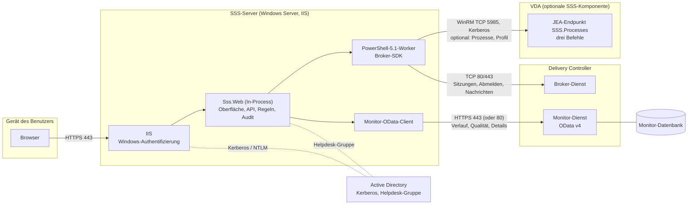
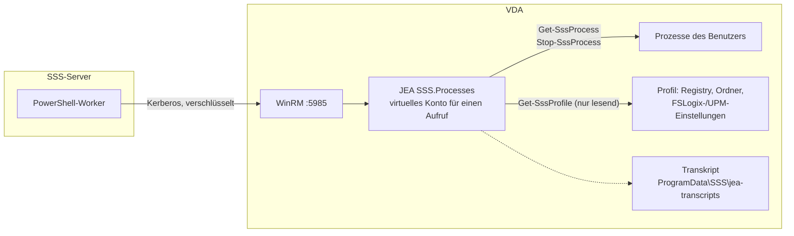

# Architektur

[English version](ARCHITECTURE.md)

SSS ist eine einzige ASP.NET-Core-Anwendung (.NET 10), die In-Process im IIS läuft. Sie liefert eine statische Single-Page-Oberfläche und eine kleine JSON-API. SSS hat keine eigene Datenbank: Alles, was angezeigt wird, kommt live von Citrix, die Identität des Benutzers von Windows.

## Überblick und Kommunikationswege



Alle Verbindungen gehen vom SSS-Server (oder vom Browser) aus. Controller und VDAs verbinden sich nie mit SSS, und SSS braucht keinen Internetzugang. Ports und Firewall-Regeln: [REQUIREMENTS.de.md](REQUIREMENTS.de.md).

### Die Komponenten

| Komponente | Läuft auf | Aufgabe | Spricht mit |
|---|---|---|---|
| **Browser** | Gerät des Benutzers | zeigt die Single-Page-Oberfläche; keine Bibliotheken, kein CDN | SSS über HTTPS (443) |
| **IIS** | SSS-Server | beendet TLS und authentifiziert per Windows-Authentifizierung (anonym aus); hostet SSS In-Process | Active Directory (Kerberos/NTLM) |
| **Sss.Web** | SSS-Server | Oberflächen-Dateien, JSON-API, Besitzprüfung, Rate-Limits, CSRF-Schutz, Audit-Log, Qualitätsbewertung | die beiden Citrix-Clients unten, Audit-Ordner |
| **PowerShell-Worker** | SSS-Server | zwei vorgewärmte Windows-PowerShell-5.1-Prozesse mit dem Broker-SDK; JSON-Zeilen über stdin/stdout; nehmen nur wenige geprüfte Operationen an | Delivery Controller (TCP 80/443); VDAs (WinRM 5985) für Prozess- und Profilfunktionen |
| **Monitor-OData-Client** | SSS-Server | liest Verlauf, letzte Messwerte und die Expertenansicht mit dem Dienstkonto | Monitor-Dienst auf dem Delivery Controller (HTTPS 443, oder 80) |
| **Broker-Dienst** | Delivery Controller | kennt die Live-Sitzungen; führt Abmeldung und Nachrichten aus | (Citrix-intern) |
| **Monitor-Dienst und -Datenbank** | Delivery Controller / SQL | Langzeitdaten von Director: Verbindungen, Anmeldeschritte, Messwerte | (Citrix-intern) |
| **VDA-Endpunkt (optional)** | jedem VDA | eingeschränkter PowerShell-Endpunkt (JEA), der Prozesse eines Benutzers auflistet und beendet und das Profil liest | beantwortet nur WinRM-Aufrufe des SSS-Servers |
| **Active Directory** | Domänencontroller | Authentifizierung, Mitgliedschaft in der Helpdesk-Gruppe, Dienstkonto (gMSA) | |
| **Dateifreigabe (optional)** | Dateiserver | gemeinsamer Schlüsselring und Audit-Ordner bei mehreren SSS-Servern | SMB 445 |

### Welche Daten woher kommen

| Was Benutzer oder Helpdesk sehen | Quelle | Weg |
|---|---|---|
| Live-Sitzungen, Status, Leerlaufzeit, Client, Anwendungen | Broker | PowerShell-Worker → Broker-SDK |
| Abmelden, Nachricht an die Sitzung | Broker | PowerShell-Worker → Broker-SDK (Besitzer doppelt geprüft) |
| Verlauf, Ampeln, Diagramme, Anmelde-Wasserfall, Expertenwerte | Monitor | OData-Client → Monitor-Dienst |
| Prozesse auflisten und beenden | VDA-Endpunkt | PowerShell-Worker → WinRM → JEA |
| Profiltyp, -größe, Ordnerbaum, Hinweise | VDA-Endpunkt | PowerShell-Worker → WinRM → JEA |
| wer der Benutzer ist, wer Helpdesk ist | Windows | IIS-Authentifizierung, AD-Gruppe |

## Die Komponente auf dem VDA

Alles oben Genannte braucht nichts auf den VDAs. Nur die optionalen Funktionen *Prozesse* und *Profilanalyse* brauchen einen kleinen **Endpunkt**, den `scripts/Install-SssJea.ps1` auf jedem VDA registriert.

**Was es ist.** Eine *Just Enough Administration*-Sitzungskonfiguration (JEA) namens `SSS.Processes`. Das ist kein Agent und kein Dienst: Auf dem VDA läuft nichts, bis sich der SSS-Server verbindet. Das Skript aktiviert WinRM (TCP 5985, mit `-AllowedFrom` auf Ihre SSS-Server beschränkbar), registriert den Endpunkt für genau die genannten Konten und legt einen Ordner für Transkripte an. Der Endpunkt bietet **drei Befehle**: `Get-SssProcess`, `Stop-SssProcess` und das nur lesende `Get-SssProfile`. Alles andere wird abgewiesen.

**Wozu sie gebraucht wird.** Citrix bietet keinen unterstützten Broker- oder Monitor-Befehl, um in eine Sitzung hineinzusehen: welche Programme laufen, wie man eines beendet, wie groß das Profil ist. Director nutzt dafür einen eigenen Kanal. SSS fragt deshalb den VDA selbst, durch diese eingeschränkte Tür. Einzelheiten und Sicherheitshinweise: [PROCESSES.de.md](PROCESSES.de.md).



### Was mit und ohne Endpunkt geht

| Funktion | Ohne Endpunkt | Mit Endpunkt |
|---|---|---|
| Eigene Sitzungen, Status, Abmelden, „Alle getrennten abmelden“ | geht | geht |
| Nachricht an eine Sitzung (Helpdesk) | geht | geht |
| Verlauf, Ampeln, Diagramme im Zeitverlauf | geht (Monitor) | geht |
| Expertenansicht: Eigenschaften, Anmelde-Wasserfall, bewertete Zeiten | geht (Monitor) | geht |
| Anwendungen und Prozesse einer Sitzung | nicht verfügbar (Schaltfläche ausgeblendet, solange die Funktion aus ist; Meldung, wenn sie an ist, der VDA aber keinen Endpunkt hat) | geht |
| Prozess beenden | nicht möglich | geht (nur eigene Prozesse des Benutzers, nie die Citrix-Sitzungsprozesse) |
| Profiltyp, -größe, Ordnerbaum, Umleitung, FSLogix-/UPM-Einstellungen, Hinweise | nicht verfügbar (Reiter *Profil* ausgeblendet oder eine Meldung erklärt es) | geht auf Abruf, nur lesend |
| Zeit „Profil laden“ im Anmelde-Wasserfall | geht (Monitor misst sie) | geht, und die Profilanalyse kann sie erklären |

Was nie möglich ist, mit oder ohne Endpunkt: eine Anwendung höflich schließen (der Endpunkt läuft in Sitzung 0 und erreicht die Fenster anderer Sitzungen nicht), eine Sitzung trennen, Dateiinhalte lesen, Befehle oder Skripte auf dem VDA ausführen, etwas anderes ändern als einen Prozess zu beenden.

Die Funktion ist standardmäßig aus (`Sss:Citrix:Processes:Enabled`). Neue SSS-Versionen können dem Endpunkt Befehle hinzufügen; nach einem solchen Update `Install-SssJea.ps1` auf den VDAs erneut ausführen.

## Software-Schichten in SSS

```
Browser ──HTTPS──> IIS (Windows-Authentifizierung, anonym aus)
                     └─ ASP.NET Core Module (In-Process)
                          └─ Sss.Web
                               ├─ wwwroot/            statische Oberfläche (HTML, CSS, JS, 5 Sprachen)
                               ├─ Program.cs          Sicherheits-Pipeline + API-Endpunkte
                               ├─ Services/SessionService   Geschäftsregeln, Audit
                               └─ ISessionProvider
                                    ├─ MockSessionProvider      Demo-Daten (Entwicklung, Tests)
                                    └─ CitrixSessionProvider
                                         ├─ BrokerWorkerPool ── vorgewärmte Windows-PowerShell-5.1-Worker ──> Broker-SDK ──> Delivery Controller
                                         └─ ODataMonitorClient ───────────────────────────────────────────> Monitor-OData ──> Delivery Controller
```

## Ablauf: Sitzungen anzeigen

1. Der IIS authentifiziert den Benutzer (Kerberos/NTLM). ASP.NET Core stellt die `WindowsIdentity` bereit, `ResolveUser` entnimmt ihr die **SID**. Nichts anderes identifiziert den Aufrufer.
2. `GET api/sessions?range=24h` → Rate-Limit (pro Benutzer) → `SessionService.GetAsync`.
3. `CitrixSessionProvider` fragt den Broker (Live-Sitzungen, **im** Broker nach SID gefiltert) und parallel Monitor (beendete Sitzungen und letzte Messwerte). Fehler bei Monitor werden zu Warnungen, ein Fehler beim Broker zu HTTP 503.
4. Die Qualität bewertet `QualityEvaluator` mit konfigurierbaren Schwellwerten: *Ihr Gerät & Netzwerk* aus ICA-Round-Trip-Zeit und verfügbarer Bandbreite, *Rechenzentrum & VDA* aus der Anmeldedauer.
5. Die Oberfläche zeigt das JSON ausschließlich über `textContent` an.

## Ablauf: Abmelden

1. `POST api/sessions/{uid}/logoff` (oder `logoff-disconnected` / `logoff-all`) → CSRF-Token-Prüfung → Rate-Limit.
2. `SessionService` lädt die **eigenen aktiven Sitzungen des Aufrufers** erneut und bildet die Schnittmenge mit der Anfrage; alles andere wird abgelehnt und protokolliert.
3. `BrokerWorkerPool` schickt nur die geprüften IDs an einen Worker. Der Worker prüft die `UserSID` jeder Sitzung **ein zweites Mal**, bevor er `Stop-BrokerSession` aufruft. Das Cmdlet arbeitet asynchron, „abgemeldet“ heißt also „Abmeldung gestartet“.
4. Jedes Ziel und jede Ablehnung landet in `logs/audit-YYYYMMDD.jsonl`.

## Bausteine

| Teil | Datei | Zweck |
|---|---|---|
| Pipeline & API | `Program.cs` | Konfigurationsprüfung, Header, Auth, CSRF, Rate-Limits, Endpunkte |
| Regeln | `Services/SessionService.cs` | Besitzprüfung, Sammelaktionen, Verlaufszeiträume |
| Qualität | `Services/QualityEvaluator.cs` | Ampeln aus Messwerten und Schwellwerten |
| Audit | `Services/AuditLog.cs` | Append-only JSON-Lines, eine Datei pro Tag |
| CSV | `Services/CsvWriter.cs` | Export mit Schutz vor Tabellenformeln |
| Provider-Schnittstelle | `Providers/ISessionProvider.cs` | was die App von einem Backend braucht |
| Demo-Backend | `Providers/MockSessionProvider.cs` | Beispieldaten zweier Benutzer |
| Broker | `Citrix/BrokerWorkerPool.cs`, `PowerShellWorker.cs`, `sss-broker-worker.ps1` | vorgewärmte Worker, JSON-Lines-Protokoll, nur `ping`/`list`/`logoff` |
| Monitor | `Citrix/ODataMonitorClient.cs` | Benutzersuche per SID, aktive und beendete Sitzungen, letzte Messwerte |
| Zusammenführung | `Citrix/CitrixSessionProvider.cs` | kombiniert Broker- und Monitor-Daten |
| Oberfläche | `wwwroot/` | abhängigkeitsfreie SPA, relative URLs, `i18n/*.json` |

## Warum PowerShell-Worker?

Das Broker-SDK gibt es nur als Windows-PowerShell-5.1-Snap-ins. Pro Anfrage PowerShell zu starten würde Sekunden dauern, deshalb hält SSS einen kleinen Pool (Standard 2) dauerhaft laufender Worker, die das Snap-in einmal laden. Nach Timeout oder Absturz wird ein Worker automatisch neu gestartet. Die Worker sprechen ein kleines zeilenweises JSON-Protokoll über stdin/stdout, und das Worker-Skript akzeptiert nur drei Operationen mit geprüften Argumenten.

## Konfigurationsreferenz

Jede Option mit Standardwert und Bedeutung: [CONFIGURATION.de.md](CONFIGURATION.de.md). Voraussetzungen und Ports: [REQUIREMENTS.de.md](REQUIREMENTS.de.md).

## Experten-Ansicht, Nachrichten, Status

- `GET api/sessions/{key}/details` (eigene) und `GET api/helpdesk/sessions/{key}/details?sid=` (Helpdesk): `ODataMonitorClient.GetDetailsAsync` liest eine Sitzung samt der letzten 240 Messpunkte und optionalen Datensätzen (`Connections`, `ConnectionFailureLogs`, `ApplicationInstances`) und liefert allgemeine *Gruppen* (Eigenschaft/Wert), *Zeitreihen* (numerische Messwerte) und *Tabellen*. Eigenschaftsnamen sind nicht fest verdrahtet, neue Citrix-Felder erscheinen daher automatisch. Siehe [DATA-SOURCES.de.md](DATA-SOURCES.de.md).
- `POST api/helpdesk/message`: Worker-Operation `message` (`Send-BrokerSessionMessage`), doppelte Besitzprüfung, protokolliert.
- `GET api/helpdesk/status`: `StatusService` führt die Prüfungen des Reiters Status aus (Version, Dienstkonto, Audit-Ordner, Broker- und Monitor-Roundtrip, HTTPS, Helpdesk-Gruppe).

## Anwendungen und Prozesse

`GET api/sessions/{uid}/processes`, `POST api/sessions/{uid}/processes/{pid}/end` (eigene Sitzungen) und die entsprechenden Endpunkte `api/helpdesk/sessions/{uid}/processes` (Helpdesk, mit `sid`) laufen über `ProcessService`, der nur Live-Sitzungen des Zielbenutzers akzeptiert und jeden Versuch protokolliert. Die Worker-Operationen `processes` und `endprocess` suchen die Sitzung erneut im Broker, verbinden sich mit `New-PSSession -ConfigurationName` zum Rechner dieser Sitzung und rufen per implizitem Remoting (`Import-PSSession`) die drei Befehle des JEA-Endpunkts auf (der dritte, `Get-SssProfile`, liest Profiltyp und Größe für `GET api/sessions/{uid}/profile`), den `scripts/Install-SssJea.ps1` auf den VDAs registriert. Details, Einrichtung und Sicherheitshinweise: [PROCESSES.de.md](PROCESSES.de.md).

Betrieb (Health-Probe, Status-Seite, Audit-Format, Fehlersuche): [OPERATIONS.de.md](OPERATIONS.de.md).

Weitere Details: [SECURITY.md](../SECURITY.md).
