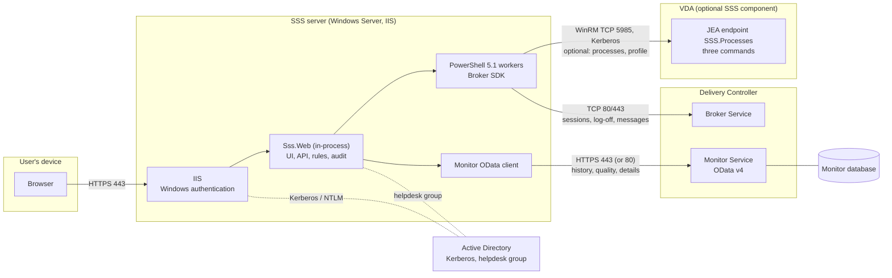
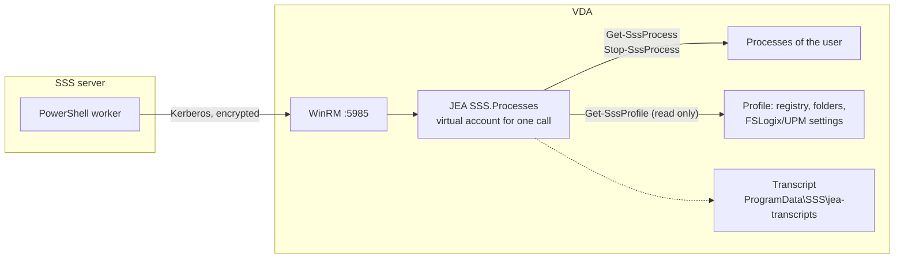

# Architecture

[Deutsche Version](ARCHITECTURE.de.md)

SSS is one ASP.NET Core application (.NET 10) hosted in-process in IIS. It serves a static single-page UI and a small JSON API. It has no database of its own: everything it shows comes live from Citrix, and the user's identity comes from Windows.

## Overview and communication paths



All connections start at the SSS server (or the browser). The controllers and VDAs never connect to SSS, and SSS needs no internet access. Ports and firewall rules: [REQUIREMENTS.md](REQUIREMENTS.md#network-and-ports).

### The components

| Component | Runs on | What it does | Talks to |
|---|---|---|---|
| **Browser** | the user's device | shows the single-page UI; no libraries, no CDN | SSS over HTTPS (443) |
| **IIS** | SSS server | terminates TLS and authenticates with Windows authentication (anonymous access off); hosts SSS in-process | Active Directory (Kerberos/NTLM) |
| **Sss.Web** | SSS server | UI files, JSON API, ownership rules, rate limits, CSRF protection, audit log, quality rating | the two Citrix clients below, the audit folder |
| **PowerShell workers** | SSS server | two warm Windows PowerShell 5.1 processes with the Broker SDK; JSON lines over stdin/stdout; accept only a few validated operations | Delivery Controller (TCP 80/443); VDAs (WinRM 5985) for process and profile operations |
| **Monitor OData client** | SSS server | reads history, the latest metrics and the expert view with the service account | Monitor Service on the Delivery Controller (HTTPS 443, or 80) |
| **Broker Service** | Delivery Controller | knows the live sessions; executes log-off and messages | (Citrix internal) |
| **Monitor Service and database** | Delivery Controller / SQL | long-term data of Director: connections, logon steps, metrics | (Citrix internal) |
| **VDA endpoint (optional)** | every VDA | restricted PowerShell endpoint (JEA) that lists and ends processes of a user and reads the profile | answers WinRM calls from the SSS server only |
| **Active Directory** | domain controllers | authentication, helpdesk group membership, service account (gMSA) | |
| **File share (optional)** | file server | shared key ring and audit folder with several SSS servers | SMB 445 |

### Which data comes from where

| What the user or helpdesk sees | Source | Path |
|---|---|---|
| live sessions, state, idle time, client, applications | Broker | PowerShell worker → Broker SDK |
| log off, message to the session | Broker | PowerShell worker → Broker SDK (owner checked twice) |
| history, traffic lights, charts, logon waterfall, expert properties | Monitor | OData client → Monitor Service |
| list and end processes | VDA endpoint | PowerShell worker → WinRM → JEA |
| profile type, size, folder tree, findings | VDA endpoint | PowerShell worker → WinRM → JEA |
| who the user is, who is helpdesk | Windows | IIS authentication, AD group |

## The component on the VDA

Everything above needs nothing on the VDAs. Only the optional features *processes* and *profile analysis* do: a small **endpoint** that `scripts/Install-SssJea.ps1` registers on each VDA.

**What it is.** A *Just Enough Administration* (JEA) session configuration called `SSS.Processes`. It is not an agent and not a service: nothing runs on the VDA until the SSS server connects. The script enables WinRM (TCP 5985, optionally restricted to your SSS servers with `-AllowedFrom`), registers the endpoint for exactly the accounts you name and creates a transcript folder. The endpoint offers **three commands**: `Get-SssProcess`, `Stop-SssProcess` and the read-only `Get-SssProfile`. Everything else is refused.

**Why it is needed.** Citrix offers no supported Broker or Monitor command to look inside a session: which programs run, how to end one, how large the profile is. Director uses its own channel for such things. SSS therefore asks the VDA itself, through this restricted door. Details and security notes: [PROCESSES.md](PROCESSES.md).



### What works with and without it

| Feature | Without the endpoint | With the endpoint |
|---|---|---|
| Own sessions, state, log off, "log off all disconnected" | works | works |
| Message to a session (helpdesk) | works | works |
| History, traffic lights, charts over time | works (Monitor) | works |
| Expert view: properties, logon waterfall, rated times | works (Monitor) | works |
| Applications and processes of a session | not available (button hidden while the feature is off; a message if it is on but the VDA has no endpoint) | works |
| End a process | not possible | works (only the user's own processes, never the Citrix session processes) |
| Profile type, size, folder tree, redirection, FSLogix/UPM settings, findings | not available (the *Profile* tab is hidden, or a message explains why) | works on demand, read only |
| "Profile load" time in the logon waterfall | works (Monitor measures it) | works, and the profile analysis can explain it |

What is never possible, with or without the endpoint: closing an application politely (the endpoint runs in session 0 and cannot reach other sessions' windows), disconnecting a session, reading file contents, running commands or scripts on the VDA, changing anything except ending a process.

The feature is off by default (`Sss:Citrix:Processes:Enabled`). New SSS releases may add commands to the endpoint; re-run `Install-SssJea.ps1` on the VDAs after such an update.

## Software layers inside SSS

```
Browser ──HTTPS──> IIS (Windows authentication, anonymous off)
                     └─ ASP.NET Core Module (in-process)
                          └─ Sss.Web
                               ├─ wwwroot/            static UI (HTML, CSS, JS, 5 languages)
                               ├─ Program.cs          security pipeline + API endpoints
                               ├─ Services/SessionService   business rules, audit
                               └─ ISessionProvider
                                    ├─ MockSessionProvider      demo data (development, tests)
                                    └─ CitrixSessionProvider
                                         ├─ BrokerWorkerPool ── warm Windows PowerShell 5.1 workers ──> Broker SDK ──> Delivery Controller
                                         └─ ODataMonitorClient ───────────────────────────────────────> Monitor OData ──> Delivery Controller
```

## Request flow (list sessions)

1. IIS authenticates the user (Kerberos/NTLM). ASP.NET Core exposes the `WindowsIdentity`; `ResolveUser` takes the **SID** from it. Nothing else identifies the caller.
2. `GET api/sessions?range=24h` → rate limit (per user) → `SessionService.GetAsync`.
3. `CitrixSessionProvider` asks the Broker (live sessions, filtered by SID **inside** the Broker query) and, in parallel, Monitor (ended sessions plus latest metrics). Monitor failures become warnings, a Broker failure becomes HTTP 503.
4. Quality is rated by `QualityEvaluator` from configurable thresholds: *your device & network* from ICA round-trip time and available bandwidth, *datacenter & VDA* from the logon duration.
5. The UI renders the JSON with `textContent` only.

## Request flow (log off)

1. `POST api/sessions/{uid}/logoff` (or `logoff-disconnected` / `logoff-all`) → CSRF token check → rate limit.
2. `SessionService` loads the **caller's own live sessions** again and intersects them with the request; everything else is rejected and audited.
3. `BrokerWorkerPool` sends only the verified ids to a worker. The worker checks `UserSID` of every session **a second time** before `Stop-BrokerSession`. The cmdlet is asynchronous, so "logged off" means "log-off started".
4. Every target and every rejection is written to `logs/audit-YYYYMMDD.jsonl`.

## Components

| Part | File | Purpose |
|---|---|---|
| Pipeline & API | `Program.cs` | configuration checks, headers, auth, CSRF, rate limits, endpoints |
| Rules | `Services/SessionService.cs` | ownership checks, bulk scopes, history ranges |
| Quality | `Services/QualityEvaluator.cs` | traffic lights from metrics and thresholds |
| Audit | `Services/AuditLog.cs` | append-only JSON lines, one file per day |
| CSV | `Services/CsvWriter.cs` | export with spreadsheet-formula neutralisation |
| Provider interface | `Providers/ISessionProvider.cs` | what the app needs from a backend |
| Demo backend | `Providers/MockSessionProvider.cs` | sample data of two users |
| Broker | `Citrix/BrokerWorkerPool.cs`, `PowerShellWorker.cs`, `sss-broker-worker.ps1` | warm workers, JSON-lines protocol, only `ping`/`list`/`logoff` |
| Monitor | `Citrix/ODataMonitorClient.cs` | user lookup by SID, live and ended sessions, latest metrics |
| Merge | `Citrix/CitrixSessionProvider.cs` | combines Broker and Monitor data |
| UI | `wwwroot/` | dependency-free SPA, relative URLs, `i18n/*.json` |

## Why PowerShell workers?

The Broker SDK exists only as Windows PowerShell 5.1 snap-ins. Starting PowerShell per request would take seconds, so SSS keeps a small pool (default 2) of long-running workers that load the snap-in once. A worker is restarted automatically after a timeout or crash. Workers speak a tiny line-delimited JSON protocol over stdin/stdout, and the worker script accepts nothing but three operations with validated arguments.

## Configuration reference

Every option with default and meaning: [CONFIGURATION.md](CONFIGURATION.md). Requirements and ports: [REQUIREMENTS.md](REQUIREMENTS.md).

## Expert view, messages, status

- `GET api/sessions/{key}/details` (own) and `GET api/helpdesk/sessions/{key}/details?sid=` (helpdesk): `ODataMonitorClient.GetDetailsAsync` reads one session plus its latest 240 metric samples, optional record sets (`Connections`, `ConnectionFailureLogs`, `ApplicationInstances`) and returns generic *groups* (property name/value pairs), *series* (numeric metrics over time) and *tables*. Property names are not hard-coded, so new Citrix fields appear automatically. See [DATA-SOURCES.md](DATA-SOURCES.md).
- `POST api/helpdesk/message`: worker operation `message` (`Send-BrokerSessionMessage`), double ownership check, audited.
- `GET api/helpdesk/status`: `StatusService` runs the health checks shown in the Status tab (version, service account, audit folder, Broker and Monitor round trips, HTTPS, helpdesk group).

## Applications and processes

`GET api/sessions/{uid}/processes`, `POST api/sessions/{uid}/processes/{pid}/end` (own sessions) and the matching `api/helpdesk/sessions/{uid}/processes` endpoints (helpdesk, with `sid`) go through `ProcessService`, which accepts only live sessions of the target user and audits every attempt. The worker operations `processes` and `endprocess` look the session up again in the Broker, connect to the machine of that session with `New-PSSession -ConfigurationName` and use implicit remoting (`Import-PSSession`) to call the three commands of the JEA endpoint (the third, `Get-SssProfile`, reads the profile type and size for `GET api/sessions/{uid}/profile`) that `scripts/Install-SssJea.ps1` registers on the VDAs. Details, setup and security notes: [PROCESSES.md](PROCESSES.md).

Operations (health probe, status page, audit format, troubleshooting): [OPERATIONS.md](OPERATIONS.md).

Further details: [SECURITY.md](../SECURITY.md).
