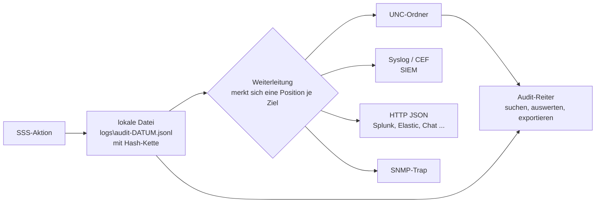

# Audit-Protokoll und zentrales Logging

[English](AUDIT.md)

Jede Aktion, die etwas ändert oder fremde Daten ansieht, kommt ins Audit-Protokoll: **wer** es getan hat (immer die Person, die geklickt hat, auch bei eigenen Aktionen), **an wem**, **wann**, **von wo**, auf **welchem Server** und in welcher **Anfrage**. Die Ticketnummer oder der Grund, den der Helpdesk eingegeben hat, gehört dazu ([Rollen](ROLES.de.md#ticketnummer-oder-grund-pflicht)).

Die virtuellen Desktops werden täglich neu gebaut, dort wird deshalb nichts protokolliert. SSS schreibt das Protokoll selbst, auf den Webservern (die dauerhaft sind), und kopiert es an zentrale Ziele.



Die lokale Datei wird **immer zuerst** geschrieben. Die Weiterleitung merkt sich je Ziel, wie weit sie gesendet hat. Ist ein Ziel nicht erreichbar, warten die Ereignisse in der lokalen Datei und werden danach zugestellt, auch nach einem Neustart (Zustellung *mindestens einmal*). Solange das Netz ausfällt, geht nichts verloren.

## Der Eintrag

Ein JSON-Objekt pro Zeile:

```json
{"id":"c699d4a7ba704e34","time":"2026-11-03T09:05:53.988+00:00","stream":"audit","action":"helpdesk-logoff:selected","user":"CORP\\alice","sid":"S-1-5-21-...","session":"2001","result":"success","ip":"10.0.5.20","actor":"CORP\\bob.helpdesk","actorSid":"S-1-5-21-...","role":"L2","reason":"INC0004711","server":"IIS01","requestId":"0HNPPH6L1VQNI:00000003","chain":"..."}
```

| Feld | Bedeutung |
|---|---|
| `id`, `time` | eindeutige Kennung, UTC-Zeit auf die Millisekunde |
| `stream` | `audit` (was Menschen getan haben) oder `ops` (Warnungen und Fehler von SSS selbst, siehe unten) |
| `actor`, `actorSid`, `role` | **wer gehandelt hat** und in welcher Rolle (`User`, `L1`..`L3`, `Auditor`, `Admin` oder eine Kombination) |
| `user`, `sid` | der Benutzer, um den es geht (Besitzer der Sitzung). Bei einer Suche ist es der Suchende. |
| `action` | was passiert ist (Liste unten) |
| `session` | die Broker-Sitzungs-ID, wenn eine beteiligt ist |
| `result` | `success`, `failed`, `rejected-not-owned-or-not-live`, eine Trefferzahl, das Ergebnis einer Prozess-Beenden-Anfrage |
| `reason` | Ticketnummer oder Grund, vom Helpdesk eingegeben |
| `detail` | wonach gefragt wurde: Suchtext, Nachrichtentext, Prozess (`pid 123`) |
| `ip` | Adresse des Browsers |
| `server`, `requestId` | der SSS-Server und die Anfrage, um einen Klick durch alle Logs zu verfolgen |
| `chain` | Hash-Kette, siehe Integrität |

Aktionen: `logoff:*`, `helpdesk-logoff:*`, `helpdesk-message`, `helpdesk:search`, `helpdesk:list-all`, `helpdesk:view`, `helpdesk:details`, `list-processes`, `end-process`, `profile-info`, `audit:view`, `audit:export` und der Alarm `alert:bulk-logoff`. Nachschlagen wird pro Helpdesk-Mitarbeiter und Benutzer nur alle fünf Minuten einmal protokolliert, damit die automatische Aktualisierung das Protokoll nicht überflutet.

## Integrität

Jede Zeile enthält den SHA-256 aus dem Kettenwert der vorherigen Zeile und dem eigenen Text. Eine geänderte, entfernte oder eingefügte Zeile in der Mitte einer Datei bricht die Kette. Der Audit-Reiter (**Integrität prüfen**) prüft die lokalen Dateien des Servers, mit dem du verbunden bist. Zwei Worker-Prozesse eines IIS-Recyclings schreiben nacheinander (die Datei wird exklusiv geöffnet), die Kette bleibt also intakt.

Grenzen: Das Entfernen der *letzten* Zeilen einer Datei ist allein an der Datei nicht erkennbar. Dafür ist die zentrale Kopie da: Ein Ziel, das der Webserver nur ergänzen darf (UNC-Ordner mit Recht *nur anfügen*, SIEM), hält den Beweis. Gib der App-Pool-Identität im zentralen Ordner kein Löschrecht.

## Ziele

Eingerichtet in `Sss:Audit:Sinks`; von jedem Typ beliebig viele. Jedes Ziel hat die Filter `Streams` (`audit`, `ops`), `Include` (nur Aktionen, die mit einem dieser Texte beginnen) und `OnlyProblems` (nur Fehler, Ablehnungen, Alarme und Betriebsprobleme).

### UNC-Ordner

```json
"Unc": [ { "Path": "\\\\fs01\\sss-audit" } ]
```

Eine Datei pro Tag, Server und Strom: `audit-YYYYMMDD-SERVER.jsonl`. Die App-Pool-Identität braucht *Schreiben* (Anfügen) auf der Freigabe. Der Audit-Reiter liest diesen Ordner ebenfalls und zeigt die Ereignisse **aller** Server, ohne Doppelte.

### Syslog und CEF

```json
"Syslog": [ { "Host": "siem01.corp.local", "Protocol": "Tls", "Format": "Cef" } ]
```

`Protocol`: `Udp` (Port 514), `Tcp` (514) oder `Tls` (6514, Serverzertifikat wird gegen den Hostnamen geprüft). `Format`: `Json` (der Eintrag unverändert) oder `Cef` (Common Event Format für ArcSight, Sentinel, QRadar, Splunk ...). `Framing`: `Newline` (Standard) oder `OctetCount` (RFC 6587). Nachricht nach RFC 5424, Facility 13 (log audit) als Standard; Schweregrad 6 für normale Ereignisse, 4 für Probleme, 1 für Alarme. CEF im Einzelnen: `suser` = Akteur, `duser` = betroffener Benutzer, `act`, `outcome`, `src`, `dvchost` und `cs1`..`cs5` = Grund, Detail, requestId, Rolle, Sitzung (mit Beschriftung).

### HTTP (JSON)

```json
"Http": [ { "Url": "https://splunk.corp.local:8088/services/collector", "Format": "SplunkHec", "AuthorizationFile": "D:\\sss-secrets\\hec-token.txt" } ]
```

`Format`: `Ndjson` (ein Objekt pro Zeile, für Loki, Graylog, allgemein), `JsonArray`, `SplunkHec`, `ElasticBulk` (mit `Index`) und `Text` (ein kurzer Satz pro Ereignis als `{"text": "..."}` für Teams-, Slack- oder Mattermost-Webhooks, kombiniere es mit `Include` und `OnlyProblems`). Die Adresse muss `https://` sein (`AllowHttp` erlaubt `http://` im Testnetz). **Geheimnisse stehen nicht in der Konfiguration:** `AuthorizationFile` nennt eine Datei, deren Inhalt der vollständige `Authorization`-Header ist (`Splunk 1234-...`, `Bearer ...`); sie wird für jede Anfrage gelesen, eine Rotation braucht also keinen Neustart. Gib der Datei nur die App-Pool-Identität als Leser. Weitere feste Header: `Headers`.

### SNMP-Trap

```json
"Snmp": [ { "Host": "nms01.corp.local", "Community": "...", "EnterpriseOid": "1.3.6.1.4.1.12345.1" } ]
```

SNMP-v2c-Trap pro Ereignis, standardmäßig nur für Probleme (`OnlyProblems` ist für diesen Typ `true`). Nimm **deine eigene** Enterprise-OID (absichtlich ohne Standardwert). Variablen unter `<OID>.1`: 1 Aktion, 2 Ergebnis, 3 Akteur, 4 Benutzer, 5 Sitzung, 6 Grund, 7 Detail, 8 Server, 9 IP, 10 Zeit; die Trap-OID ist `<OID>.0.1`. Die Community geht im Klartext über das Netz und v3 wird nicht unterstützt: nur im Management-Netz nutzen. Für alles Vertrauliche Syslog über TLS oder HTTPS verwenden.

Ein neues Ziel beginnt mit dem, was **ab jetzt** geschrieben wird; ältere Historie bleibt in den Dateien (bei Bedarf von Hand kopieren). Ein nicht erreichbares Ziel erscheint im Status-Reiter (Admin) und im Audit-Reiter als Fehler mit der Meldung; im Betriebsstrom steht alle zehn Minuten eine Nachricht dazu.

## Betriebsstrom

Warnungen und Fehler von SSS selbst (Controller-Failover, Worker-Probleme, ein ausgefallenes Ziel, ein unbehandelter Fehler) landen in einem zweiten Strom `ops` neben dem Audit-Protokoll, `ops-YYYYMMDD.jsonl`, über dieselben Ziele. Gleiche Meldungen werden einmal pro Minute geschrieben. Abschalten mit `Sss:Audit:OpsStream` = `false`.

## Der Audit-Reiter

Nur für die Rolle **Auditor** sichtbar. Filtern nach Zeitraum (24 Stunden bis 90 Tage), Akteur, betroffenem Benutzer, Aktion, Ergebnis, Server, Strom und Freitext (Ticket, Detail, Sitzung, Request-ID). Die Ansicht zeigt die Ereignisse pro Tag, die aktivsten Personen, die Aktionen, Ergebnisse und Server (ein Eintrag lässt sich anklicken, um zu filtern), die Ereignisse selbst mit den neuesten zuerst, den Zustand der Ziele und die Integritätsprüfung. **CSV exportieren** schreibt die gefilterten Ereignisse (Formelzeichen werden für Excel entschärft). Öffnen und Exportieren werden als `audit:view` und `audit:export` protokolliert.

Der Viewer liest den lokalen Ordner und die Ordner aller UNC-Ziele. Mit einem UNC-Ziel zeigt er daher die ganze Farm, sonst nur den Server, mit dem du verbunden bist (ein Load Balancer schickt dich beim nächsten Mal vielleicht zu einem anderen).

## Aufbewahrung und Datenschutz

`Sss:Audit:RetentionDays` löscht lokale Dateien, die älter als so viele Tage sind, aber erst, nachdem jedes Ziel sie passiert hat (0 = alles behalten, Standard). Die zentralen Kopien werden nicht angefasst: die Aufbewahrung des Ziels dort festlegen.

Das Protokoll enthält personenbezogene Daten der Helpdesk-Mitarbeiter (wer wen angesehen hat und warum) und der Benutzer. Stimme Aufbewahrungsdauer, Zugriff (die Rolle Auditor) und Zweck mit dem Datenschutzbeauftragten und, wo vorhanden, dem Betriebsrat ab, bevor du die zentrale Sammlung einschaltest. SSS speichert nichts über den *Inhalt* einer Benutzersitzung.
