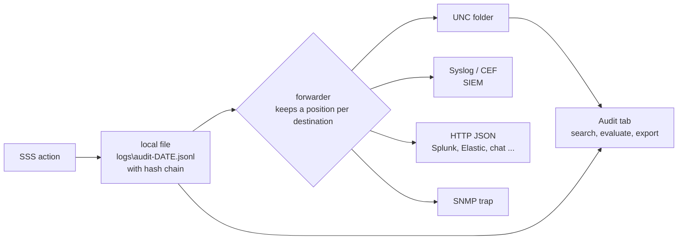

# Audit trail and central logging

[Deutsch](AUDIT.de.md)

Every action that changes something or looks at somebody else's data is written to the audit trail, with **who** did it (always the person who clicked, also for the user's own actions), **to whom**, **when**, **from where**, on **which server** and in which **request**. The ticket number or reason the helpdesk entered is part of it ([roles](ROLES.md#ticket-number-or-reason-mandatory)).

The virtual desktops are rebuilt every day, so nothing is logged there. SSS writes the trail itself, on the web servers (which are persistent), and copies it to central destinations.



The local file is **always written first**. The forwarder remembers per destination how far it has sent. If a destination is down, the events wait in the local file and are delivered afterwards, also after a restart (delivery is *at least once*). Nothing is lost while the network is down.

## The record

One JSON object per line:

```json
{"id":"c699d4a7ba704e34","time":"2026-11-03T09:05:53.988+00:00","stream":"audit","action":"helpdesk-logoff:selected","user":"CORP\\alice","sid":"S-1-5-21-...","session":"2001","result":"success","ip":"10.0.5.20","actor":"CORP\\bob.helpdesk","actorSid":"S-1-5-21-...","role":"L2","reason":"INC0004711","server":"IIS01","requestId":"0HNPPH6L1VQNI:00000003","chain":"..."}
```

| Field | Meaning |
|---|---|
| `id`, `time` | unique id, UTC time to the millisecond |
| `stream` | `audit` (what people did) or `ops` (warnings and errors of SSS itself, see below) |
| `actor`, `actorSid`, `role` | **who acted** and in which role (`User`, `L1`..`L3`, `Auditor`, `Admin`, or a combination) |
| `user`, `sid` | the user the action is about (the owner of the session). For a search it is the searcher. |
| `action` | what happened (list below) |
| `session` | the Broker session id when one is involved |
| `result` | `success`, `failed`, `rejected-not-owned-or-not-live`, a hit count, the outcome of an end-process request |
| `reason` | the ticket number or reason entered by the helpdesk |
| `detail` | what was asked for: search text, message text, process (`pid 123`) |
| `ip` | client address of the browser |
| `server`, `requestId` | the SSS server and the request, to follow one click through all logs |
| `chain` | hash chain, see integrity |

Actions: `logoff:*`, `helpdesk-logoff:*`, `helpdesk-message`, `helpdesk:search`, `helpdesk:list-all`, `helpdesk:view`, `helpdesk:details`, `list-processes`, `end-process`, `profile-info`, `audit:view`, `audit:export`, and the alert `alert:bulk-logoff`. Looking things up is logged once per five minutes per helpdesk member and user, so the automatic refresh does not flood the trail.

## Integrity

Each line contains the SHA-256 of the previous line's chain value and its own text. A changed, removed or inserted line in the middle of a file breaks the chain. The Audit tab (**Check integrity**) verifies the local files of the server you are connected to. Two worker processes of an IIS recycle write one after the other (the file is opened exclusively), so the chain stays intact.

Limits: removing the *last* lines of a file is not detectable from the file alone. That is what the central copy is for: a destination the web server may only append to (UNC folder with *append only* rights, SIEM) keeps the evidence. Give the app pool identity no right to delete in the central folder.

## Destinations

Configured in `Sss:Audit:Sinks`; any number of each type. Every destination has the filters `Streams` (`audit`, `ops`), `Include` (only actions starting with one of these texts) and `OnlyProblems` (failures, rejections, alerts and operational problems only).

### UNC folder

```json
"Unc": [ { "Path": "\\\\fs01\\sss-audit" } ]
```

One file per day, server and stream: `audit-YYYYMMDD-SERVER.jsonl`. The app pool identity needs *write* (append) on the share. The Audit tab reads this folder too and shows the events of **all** servers, without duplicates.

### Syslog and CEF

```json
"Syslog": [ { "Host": "siem01.corp.local", "Protocol": "Tls", "Format": "Cef" } ]
```

`Protocol`: `Udp` (port 514), `Tcp` (514) or `Tls` (6514, server certificate checked against the host name). `Format`: `Json` (the record as is) or `Cef` (Common Event Format for ArcSight, Sentinel, QRadar, Splunk ...). `Framing`: `Newline` (default) or `OctetCount` (RFC 6587). RFC 5424 message, facility 13 (log audit) by default; severity 6 for normal events, 4 for problems, 1 for alerts. Details for CEF: `suser` = actor, `duser` = affected user, `act`, `outcome`, `src`, `dvchost`, and `cs1`..`cs5` = reason, detail, requestId, role, session (with labels).

### HTTP (JSON)

```json
"Http": [ { "Url": "https://splunk.corp.local:8088/services/collector", "Format": "SplunkHec", "AuthorizationFile": "D:\\sss-secrets\\hec-token.txt" } ]
```

`Format`: `Ndjson` (one object per line, for Loki, Graylog, generic), `JsonArray`, `SplunkHec`, `ElasticBulk` (with `Index`), and `Text` (one short sentence per event as `{"text": "..."}` for Teams, Slack or Mattermost webhooks, combine it with `Include` and `OnlyProblems`). The address must be `https://` (`AllowHttp` allows `http://` in a test network). **Secrets are not written into the configuration:** `AuthorizationFile` names a file whose content is the complete `Authorization` header value (`Splunk 1234-...`, `Bearer ...`); it is read for every request, so a rotation needs no restart. Give the file only the app pool identity as reader. Further fixed headers: `Headers`.

### SNMP trap

```json
"Snmp": [ { "Host": "nms01.corp.local", "Community": "...", "EnterpriseOid": "1.3.6.1.4.1.12345.1" } ]
```

SNMP v2c trap per event, by default only for problems (`OnlyProblems` is `true` for this type). Use **your own** enterprise OID (no default on purpose). Variables below `<OID>.1`: 1 action, 2 result, 3 actor, 4 user, 5 session, 6 reason, 7 detail, 8 server, 9 ip, 10 time; the trap OID is `<OID>.0.1`. The community travels in clear text and v3 is not supported: use it inside the management network only. For anything that has to be confidential use Syslog over TLS or HTTPS.

A new destination starts with what is written **from now on**; older history stays in the files (copy it by hand if you need it). A destination that cannot be reached appears in the Status tab (Admin) and in the Audit tab as a failure with the error; a message about it is written to the operations stream once in ten minutes.

## Operations stream

Warnings and errors of SSS itself (controller failover, worker problems, a failing destination, an unhandled error) go into a second stream `ops` next to the audit trail, `ops-YYYYMMDD.jsonl`, through the same destinations. Identical messages are written once a minute. Switch it off with `Sss:Audit:OpsStream` = `false`.

## The Audit tab

Visible for the **Auditor** role only. Filter by period (24 hours to 90 days), actor, affected user, action, result, server, stream and free text (ticket, detail, session, request id). The view shows the events per day, the most active people, the actions, results and servers (click an entry to filter), the events themselves with the newest first, the state of the destinations and the integrity check. **Export CSV** writes the filtered events (formula characters are neutralised for Excel). Opening and exporting are audited as `audit:view` and `audit:export`.

The viewer reads the local folder and the folders of all UNC destinations. With a UNC destination it therefore shows the whole farm, otherwise only the server you are connected to (a load balancer may send you to another one next time).

## Retention and privacy

`Sss:Audit:RetentionDays` deletes local files older than that many days, but only after every destination has passed them (0 = keep everything, the default). The central copies are not touched: apply the retention of the destination there.

The trail contains personal data of the helpdesk staff (who looked at whom and why) and of the users. Agree the retention period, the access (the Auditor role) and the purpose with your data protection officer and, where one exists, the works council before you switch on central collection. SSS stores nothing about the *content* of a user's session.
