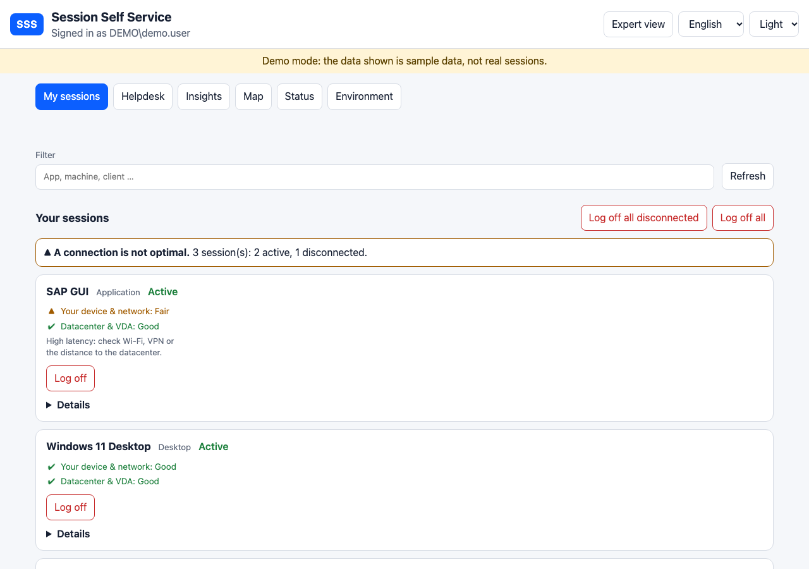
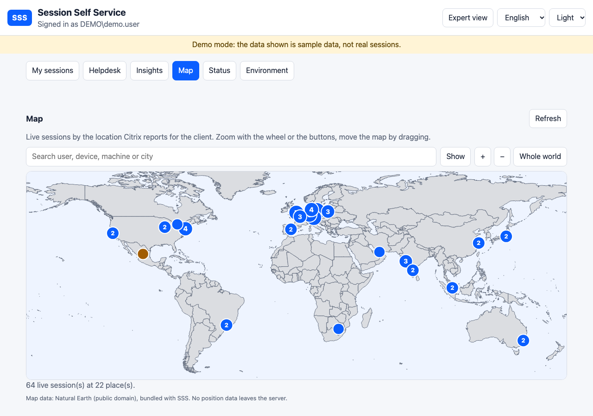
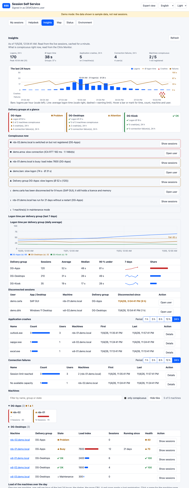
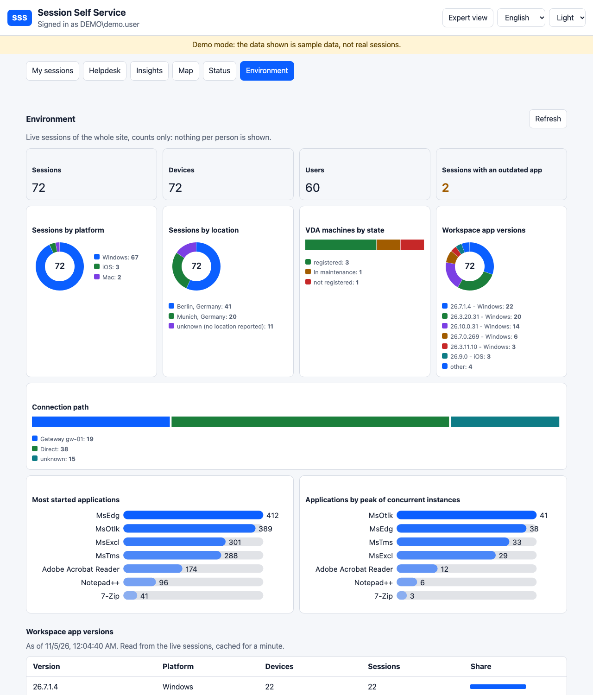
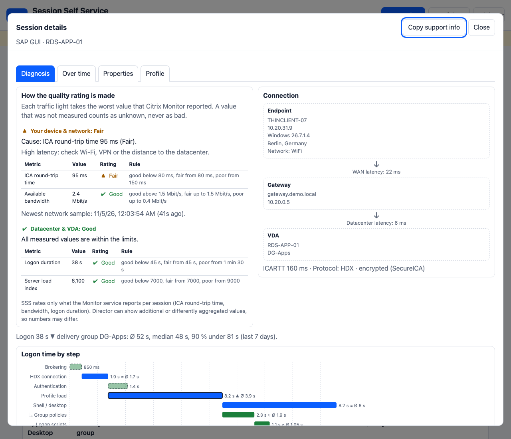
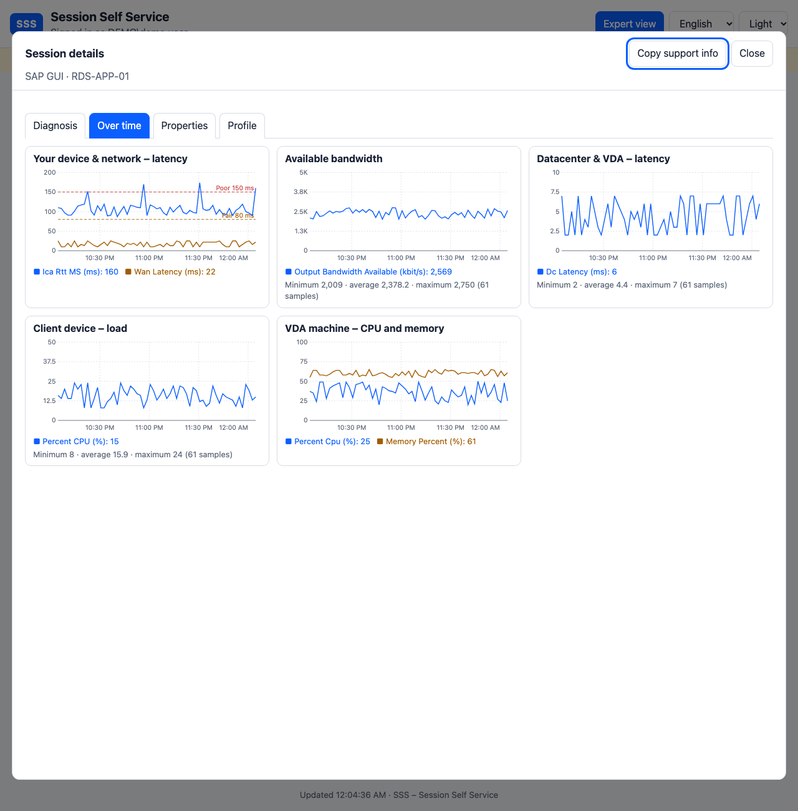
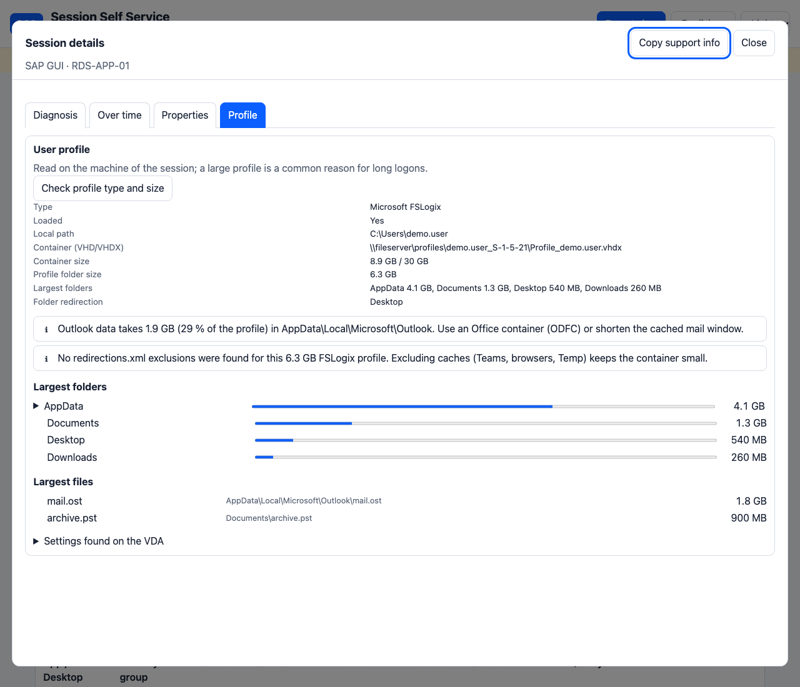
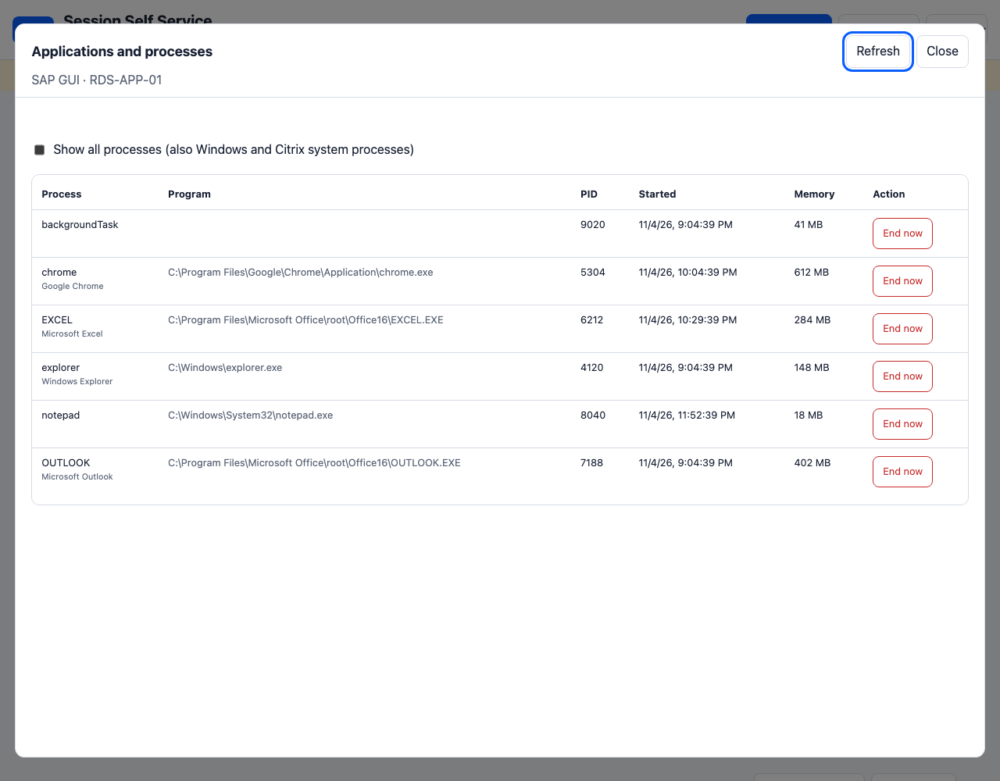

# Bildergalerie

[English](GALLERY.md)

Alle Bilder zeigen den eingebauten Demo-Modus mit erfundenen Daten; keines stammt aus einer echten Umgebung. Sie werden mit `scripts/Make-Screenshots.sh` neu erzeugt.

## Übersicht eines Benutzers: Sitzungen mit Qualitäts-Ampeln

## Weltkarte: woher kommen die Sitzungen, Suche nach einem Benutzer

## Insights: was gerade auffällt, Anmeldezeit je Gruppe, Abstürze und Verbindungsfehler

## Umgebung: Plattformen, Standorte, VDA-Maschinen, am häufigsten gestartete Anwendungen

## Expertenansicht: Diagnose, Topologie, Anmelde-Wasserfall, Diagramme

## Verlauf: die Leistungsdiagramme einer Sitzung

## Profilanalyse mit Befunden und Ordnerbaum

## Anwendungen und Prozesse einer Sitzung

