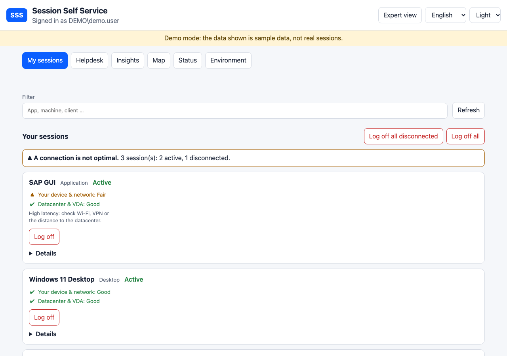
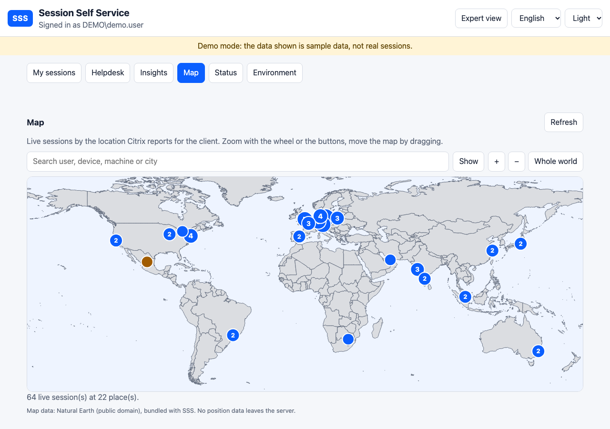
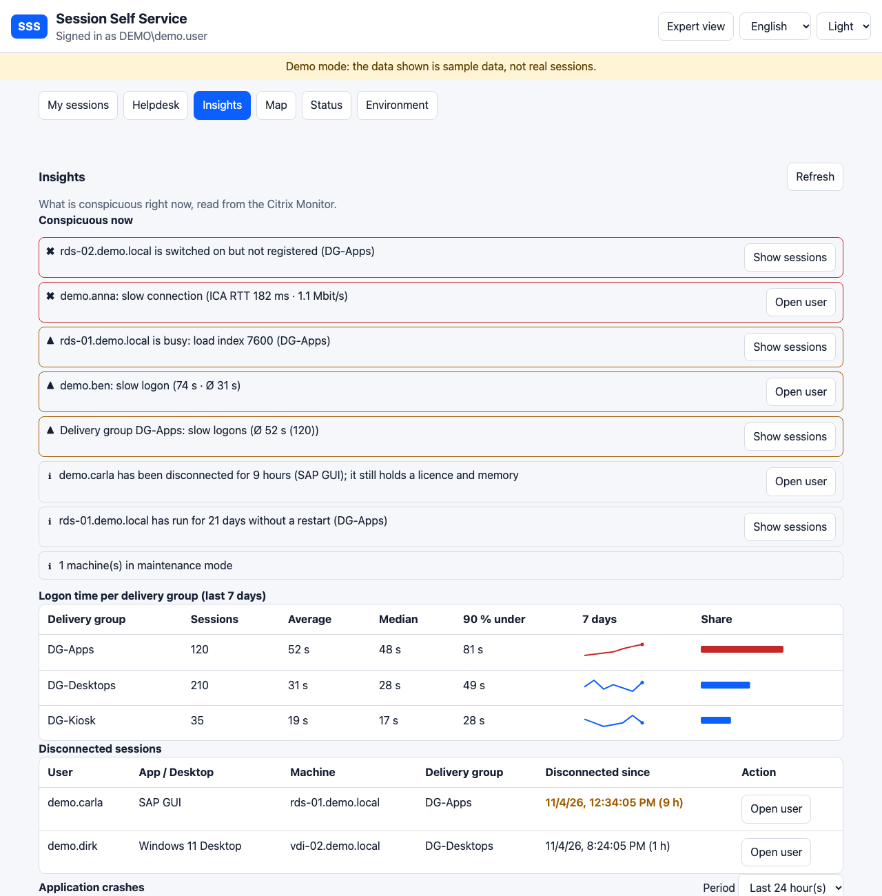
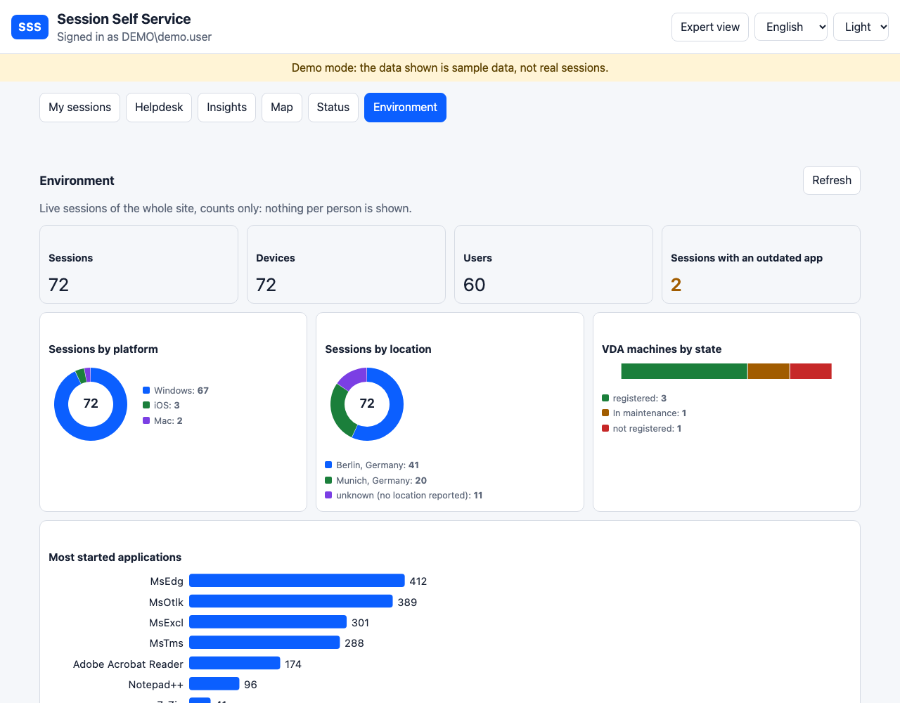
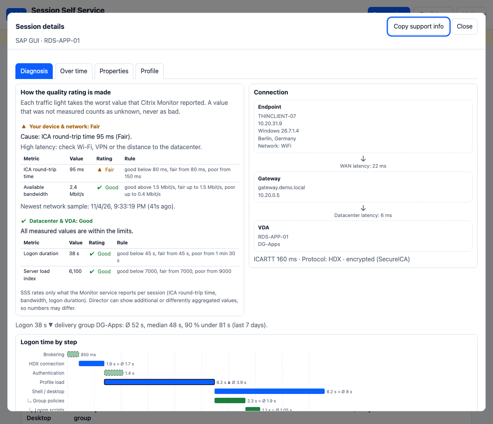
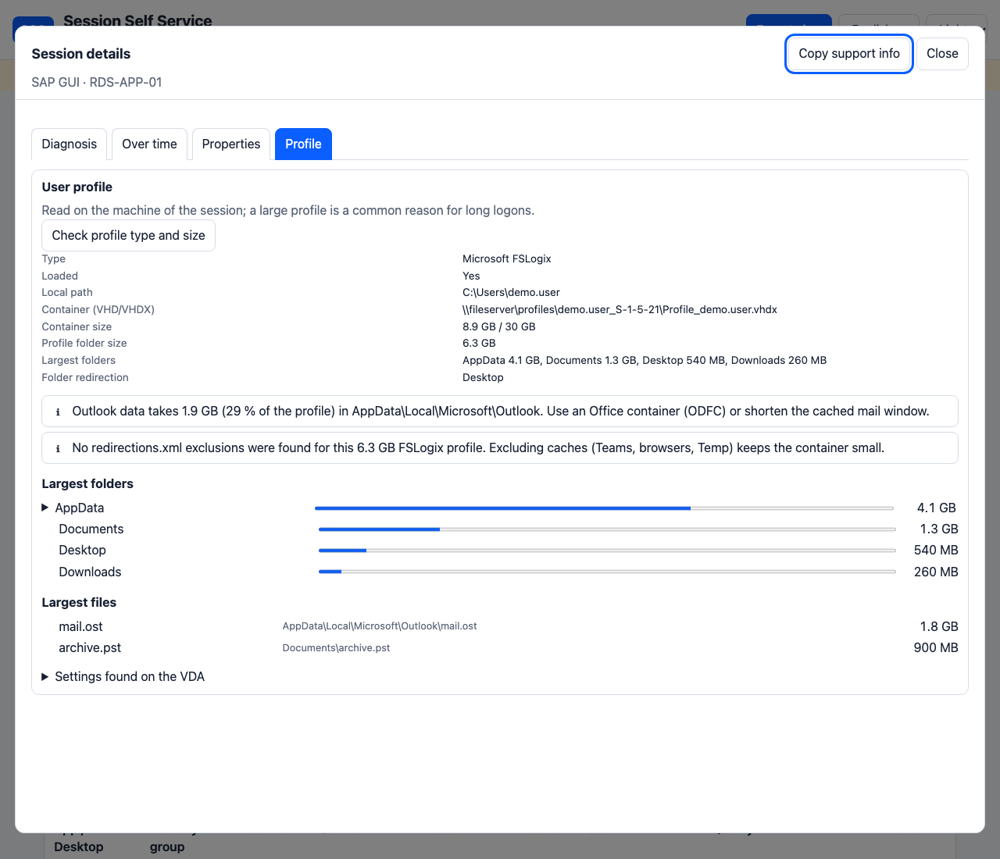
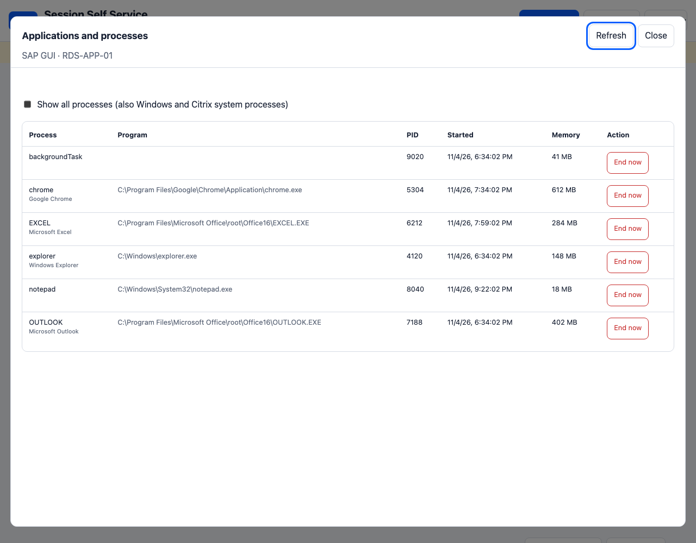

# Gallery

[Deutsch](GALLERY.de.md)

All pictures show the built-in demo mode with invented data; none comes from a real site. They are recreated with `scripts/Make-Screenshots.sh`.

## Overview of a user: sessions with quality traffic lights

## World map: where do the sessions come from, search for a user

## Insights: what is conspicuous right now, logon time per group, crashes and failures

## Environment: platforms, locations, VDA machines, most started applications

## Expert view: diagnosis, topology, logon waterfall, graphs

## Profile analysis with findings and folder tree

## Applications and processes of a session

