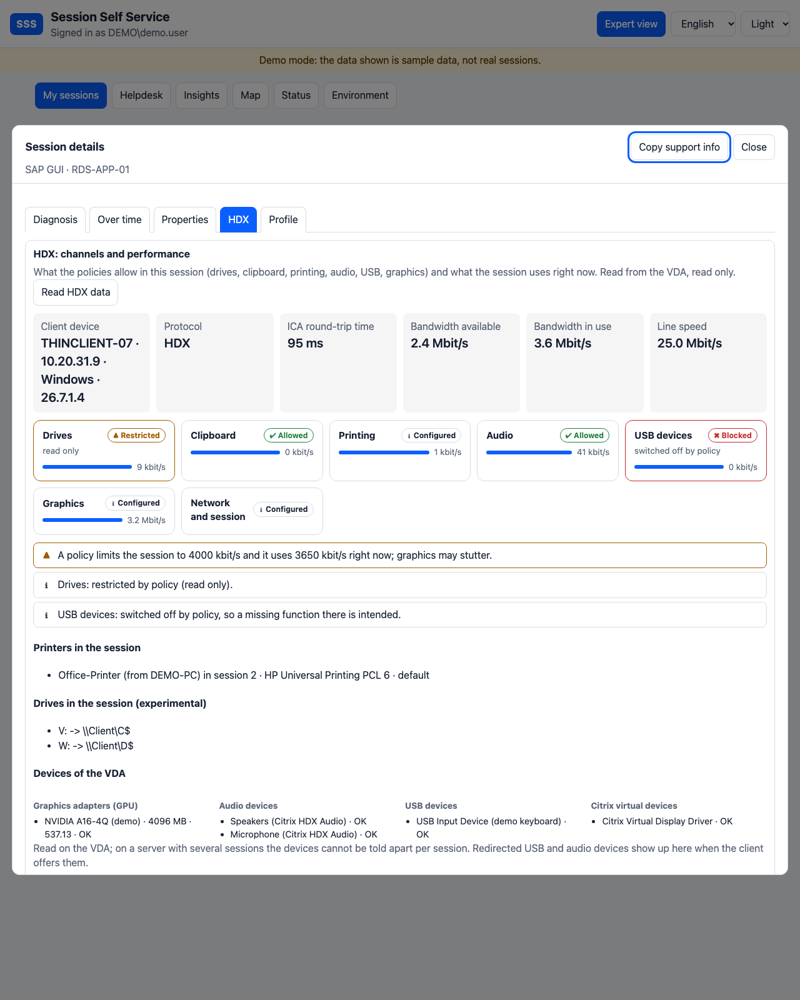

# HDX: Kanäle, Richtlinien und Leistung einer Sitzung

[English version](HDX.md)

Der Reiter **HDX** in der Expertenansicht beantwortet die Fragen, die der Support zu einer langsamen Citrix-Sitzung oder einer Funktion stellt, die „nicht geht“: Darf der Benutzer Dateien vom Client kopieren? Warum funktioniert Einfügen nicht? Ist der Drucker da? Fehlt der Sitzung Bandbreite? Er wird **auf Knopfdruck** gelesen (*HDX-Daten lesen*), nur lesend, und jedes Lesen wird protokolliert (`hdx-info`). Benutzer sehen ihn für die eigenen Sitzungen, der Helpdesk (Stufe 3, mit dem Feld für den Grund) für den geöffneten Benutzer.

## Was der Reiter zeigt

| Teil | Inhalt | Quelle |
|---|---|---|
| Kennzahlen | Protokoll, ICA-Laufzeit, verfügbare und genutzte Bandbreite, Leitungsgeschwindigkeit | Monitor (Sitzungsmesswerte) und VDA-Zähler |
| Kanalkacheln | **Laufwerke, Zwischenablage, Drucken, Audio, USB-Geräte, Grafik, Netzwerk und Sitzung**, je *erlaubt*, *eingeschränkt* (nur lesen, nur zum Client ...), *gesperrt*, *konfiguriert* oder *nicht gesetzt*, mit der Live-Nutzung je Kanal als Balken | die **wirksamen Citrix-Richtlinien** (wie im Reiter Policies) und die VDA-Zähler |
| Befunde | im Klartext: „USB-Geräte: per Richtlinie abgeschaltet, eine fehlende Funktion dort ist also gewollt“, „eine Richtlinie begrenzt die Sitzung auf 4000 kbit/s, aktuell werden 3650 kbit/s genutzt“ | Regeln in SSS |
| Drucker | die Drucker, die der Client in der Sitzung angelegt hat | VDA (Windows-Drucker der Sitzung) |
| Laufwerke | in der Sitzung verbundene Laufwerke (Client-Laufwerke erscheinen als `\\Client\C$`), über die Anmeldesitzungen des Benutzers gefunden (**experimentell**) | VDA (WMI) |
| Geräte | Grafikadapter (GPU) mit Speicher und Treiber, Audiogeräte, USB-Geräte und virtuelle Citrix-Geräte des VDA | VDA (WMI) |
| Endgerät | Name, Adresse, Plattform und Version der Workspace-App | Broker und Monitor |
| Verlauf | Latenz- und Bandbreitenreihen der Sitzung | Monitor |

Der Helpdesk kann die rohen **Richtlinienwerte** hinter jeder Kachel öffnen; Benutzer sehen nur die bewerteten Gruppen, nicht die Richtliniennamen.

## Wie die Bewertung funktioniert

Der VDA legt die Richtlinien als Registrywerte unter `HKLM\SOFTWARE\Policies\Citrix\<Sitzungs-ID>` ab; die Namen der Richtlinien gehören nicht dazu. SSS ordnet deshalb jeden Wert über Namensbestandteile (*drive*, *clipboard*, *print*, *audio*, *usb*, *bandwidth* ...) einer Kanalgruppe zu und liest die üblichen Wertformen: `Allowed` / `Prohibited`, `ReadOnly`, `ToClient`, `0` / `1` (die Wörter *Allow*, *Enable*, *Prohibit*, *Disable* im Namen sagen, wie herum es zu lesen ist). Ein sperrender Wert macht die Gruppe *gesperrt*. Einen Wert, den SSS nicht bewerten kann, lässt es bei *konfiguriert* und zeigt ihn unverändert. Eine Gruppe ohne Richtlinie ist *nicht gesetzt*: Es gilt die Voreinstellung von Citrix, meist „erlaubt“.

Das ist eine **Bewertung nach Namen**, keine Kopie der Regeln von Citrix. Sagt eine Kachel etwas anderes, als du weißt, öffne die Richtlinienwerte der Kachel: Sie werden immer unverändert angezeigt.

## Live-Werte vom VDA (`Get-SssHdx`)

Der Live-Teil braucht den nur lesenden JEA-Befehl `Get-SssHdx`, der mit `Install-SssJea.ps1` kommt (siehe [Prozesse](PROCESSES.de.md)). **Führe das aktualisierte Skript auf den VDAs aus** (oder im Master-Image). Er liest

- die Leistungszähler der Gruppe **ICA Session** für die Sitzung: Bandbreite je virtuellem Kanal (Audio, Zwischenablage, Laufwerke, Drucken, Grafik), Leitungsgeschwindigkeit, Latenz. SSS liest die Zähler als **Bit pro Sekunde**;
- die Drucker, die der Client in dieser Sitzung angelegt hat;
- die in dieser Sitzung verbundenen Laufwerke;
- die Grafikadapter, Audiogeräte, USB-Geräte und virtuellen Citrix-Geräte des VDA.

Namen von Zählern unterscheiden sich je nach VDA-Version. Jeder Teil wird einzeln versucht; schlägt einer fehl, zeigen die anderen weiter, und der Helpdesk findet unter *Hinweise des VDA* eine kurze Notiz (zum Beispiel die gefundenen Zählerinstanzen). Fehlt der neue Befehl auf dem VDA, zeigt der Reiter weiter die aus den Richtlinien bewerteten Gruppen und sagt, dass Live-Werte fehlen.

## Grenzen

- Welche Laufwerke **wirklich** verbunden sind, wird von außerhalb der Sitzung gelesen und kann unvollständig sein; sieh die Liste als Hinweis.
- Drucker werden über die Sitzungsnummer in ihrem Namen (in jeder Sprache) der Sitzung zugeordnet, die Ansicht eines Benutzers listet also nie die Drucker anderer Sitzungen. Audio-, USB- und Citrix-Geräte werden je VDA gelesen: Auf einem Einzelsitzungs-VDI sind es die Geräte der Sitzung; auf einem Server mit mehreren Sitzungen lassen sie sich nicht trennen und werden zum Schutz der anderen Benutzer **nicht angezeigt** (die Grafikadapter als Hardware schon). Welche USB- oder Audiogeräte der Client **anbietet**, sieht der VDA erst, wenn sie umgeleitet sind.
- Die Druckerliste hängt davon ab, wie der VDA die Drucker einer Sitzung benennt.
- Richtlinien, die Citrix unter einem SSS unbekannten Namen anlegt, erscheinen als *konfiguriert* oder werden keiner Gruppe zugeordnet. Im Reiter Policies bleiben sie sichtbar.
- Citrix Cloud (schreibgeschützter Modus) hat keinen VDA-Zugriff; der Reiter wird dort nicht angeboten.
