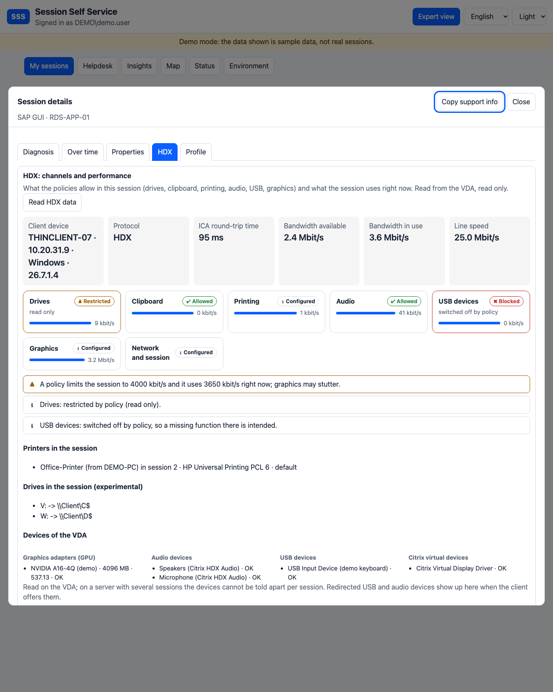

# HDX: channels, policies and performance of a session

[Deutsche Version](HDX.de.md)

The **HDX** tab of the expert view answers the questions a support person asks about a Citrix session that is slow or "does not do something": Is copying files from the client allowed? Why does pasting not work? Is the printer there? Is the session short of bandwidth? It is read **on demand** (button *Read HDX data*), read only, and every read is audited (`hdx-info`). Users see it for their own sessions; the helpdesk (level 3, with the reason field) for the user it has opened.

## What the tab shows

| Part | Content | Source |
|---|---|---|
| Key figures | protocol, ICA round-trip time, bandwidth available, in use, line speed | Monitor (session metrics) and VDA counters |
| Channel tiles | **drives, clipboard, printing, audio, USB devices, graphics, network and session**, each *allowed*, *restricted* (read only, to the client only ...), *blocked*, *configured* or *not set*, with the live use per channel as a bar | the **Citrix policies in force** (as in the Policies tab) and the VDA counters |
| Findings | plain language: "USB devices: switched off by policy, so a missing function there is intended", "a policy limits the session to 4000 kbit/s and it uses 3650 kbit/s" | rules in SSS |
| Printers | the printers the client created in the session | VDA (Windows printers of the session) |
| Drives | drives mapped in the session (client drives appear as `\Client\C$`), found through the logon sessions of the user (**experimental**) | VDA (WMI) |
| Devices | graphics adapters (GPU) with memory and driver, sound devices, USB devices and Citrix virtual devices of the VDA | VDA (WMI) |
| Client device | name, address, platform and Workspace app version | Broker and Monitor |
| Over time | latency and bandwidth series of the session | Monitor |

The helpdesk can open the raw **policy values** behind each tile; users see only the rated groups, not the policy names.

## How the rating works

The VDA stores the policies as registry values below `HKLM\SOFTWARE\Policies\Citrix\<session id>`; the names of the policies are not part of it. SSS therefore assigns each value to a channel group by fragments of its name (*drive*, *clipboard*, *print*, *audio*, *usb*, *bandwidth* ...) and reads the usual shapes of the value: `Allowed` / `Prohibited`, `ReadOnly`, `ToClient`, `0` / `1` (the words *Allow*, *Enable*, *Prohibit*, *Disable* in the name say which way round it reads). One blocking value makes the group *blocked*. A value SSS cannot rate leaves the group at *configured* and shows the value as it is. A group without any policy is *not set*: the default of Citrix applies, which is usually "allowed".

This is a **rating by name**, not a copy of Citrix's rules. If a tile says something different from what you know, open the policy values of that tile: they are always shown as they are.

## Live values from the VDA (`Get-SssHdx`)

The live part needs the read-only JEA command `Get-SssHdx`, which comes with `Install-SssJea.ps1` (see [Processes](PROCESSES.md)). **Run the updated script on the VDAs** (or in the master image). It reads

- the performance counters of the set **ICA Session** for the session: bandwidth per virtual channel (audio, clipboard, drives, printing, graphics), line speed, latency. SSS reads the counters as **bits per second**;
- the printers the client created in that session;
- the drives mapped in that session;
- the graphics adapters, sound devices, USB devices and Citrix virtual devices of the VDA.

Counter names differ between VDA versions. Every part is tried on its own; if one fails, the others still show and the helpdesk finds a short note under *Notes of the VDA* (for example the counter instances it found). Without the new command on the VDA the tab still shows the groups rated from the policies and says that live values are missing.

## Limits

- Which drives are **really** connected is read from outside the session and may be incomplete; treat the list as a hint.
- Printers are matched to the session by the session number in their name (in any language), so a user's view never lists the printers of other sessions. Audio, USB and Citrix devices are read per VDA: on a single-session VDI they are the session's devices; on a server with several sessions they cannot be told apart and are **not shown**, to protect the other users (the graphics adapters, which are hardware, still are). Which USB or audio devices the client **offers** is not visible to the VDA until they are redirected.
- The list of printers depends on how the VDA names the printers of a session.
- Policies that Citrix applies by a name SSS does not know show up as *configured* or are not assigned to a group. They stay visible in the Policies tab.
- Citrix Cloud (read-only mode) has no VDA access; the tab is not offered there.
