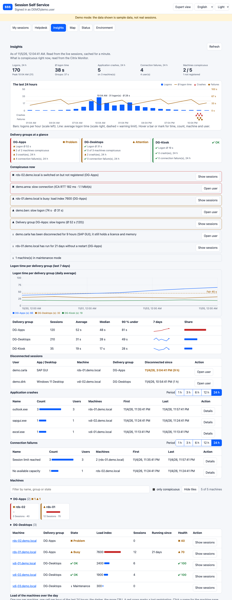

# Insights, Karten und Benutzer-Verlauf

[English](INSIGHTS.md)

## Reiter Insights (alle Helpdesk-Stufen)

Der Reiter **Insights** beantwortet „Was ist gerade auffällig?“, ohne eine Sitzung zu öffnen. Er liest den Citrix Monitor und braucht keine zusätzliche Einrichtung. Das Ergebnis wird eine Minute zwischengespeichert.

**Jetzt auffällig** listet, das Schwerste zuerst (jeweils mit Symbol und Text, nicht nur mit Farbe):

| Befund | Wann | Knopf |
|---|---|---|
| Langsame Verbindung | eine Live-Sitzung hat ICA-Laufzeit oder verfügbare Bandbreite jenseits der Grenzen von `Sss:Quality` | Benutzer öffnen |
| Langsame Anmeldung | eine Sitzung der letzten 24 Stunden meldete sich langsamer an als `LogonWarnSeconds` **und** mindestens 1,5-mal langsamer als der Durchschnitt ihrer Bereitstellungsgruppe | Benutzer öffnen |
| Langsame Bereitstellungsgruppe | die durchschnittliche Anmeldezeit der Gruppe der letzten 7 Tage liegt jenseits der Grenze | Sitzungen zeigen |
| Maschine nicht registriert | eine Maschine ist eingeschaltet, aber nicht am Delivery Controller registriert (nicht im Wartungsmodus) | Sitzungen zeigen |
| Maschine ausgelastet | der Lastindex einer registrierten Maschine liegt über `LoadWarn` oder `LoadCrit` | Sitzungen zeigen |
| Lange getrennt | eine Sitzung ist seit 4 Stunden oder länger getrennt (sie belegt weiter Lizenz und Speicher), nach der Leerlaufzeit des Brokers | Benutzer öffnen |
| Läuft sehr lange | eine registrierte Maschine läuft seit 14 Tagen oder länger ohne Neustart | Sitzungen zeigen |
| Wartung | Anzahl der Maschinen im Wartungsmodus (Information) | |

*Benutzer öffnen* zeigt die Sitzungen des Benutzers, dort gibt es Abmelden, Nachricht und die Expertenansicht. *Sitzungen zeigen* öffnet die Helpdesk-Liste, gefiltert auf die Maschine oder Bereitstellungsgruppe.

**Anmeldezeit je Bereitstellungsgruppe** zeigt Anzahl, Durchschnitt, Median und die Zeit, unter der 90 % der Anmeldungen bleiben (Sitzungen der letzten 7 Tage mit Anmeldedauer). Sie wird aus den Sitzungsdatensätzen des Monitors berechnet und funktioniert deshalb auch dort, wo die Zusammenfassungstabellen des Monitors leer sind.

Die Tabelle zeigt außerdem den **Durchschnitt jedes der letzten 7 Tage** als kleine Kurve, damit eine schleichende Verschlechterung auffällt und nicht nur der Durchschnitt. Eine Gruppe mit weniger als 5 Sitzungen erscheint grau und wird nicht bewertet.

**Getrennte Sitzungen** listet jede getrennte Sitzung mit Benutzer, Anwendung, Maschine, Bereitstellungsgruppe und seit wann (nach der Zustandsänderung des Brokers), die längste zuerst. Sitzungen, die seit 4 Stunden oder länger getrennt sind, stehen zusätzlich unter *Jetzt auffällig*.

**Anwendungsabstürze** und **Verbindungsfehler** lassen sich auf die letzten **1, 3, 6, 12 und 24 Stunden** umschalten. Jede Zeile zählt eine Anwendung (oder einen Fehlergrund) mit Zahl der Benutzer, den Maschinen (und der Maschine mit den meisten), erstem und letztem Zeitpunkt. **Details** öffnet jeden einzelnen Eintrag: wann, welcher Benutzer (mit Knopf zu dessen Sitzungen), Maschine, Bereitstellungsgruppe, Client-Gerät und alles, was der Monitor sonst dazu liefert (bei einem Absturz Version, Programmpfad und Fehlerbeschreibung). Über den Einträgen benennt ein Hinweis das Muster: ein Benutzer auf einer Maschine, überwiegend eine Maschine (Maschine ansehen: Patches, Updates, Datenträger), ein Benutzer auf mehreren Maschinen (Benutzer ansehen: Profil, Einstellungen) oder breit gestreut (nach einer jüngsten Änderung suchen). Der Fehlergrund ist der Text, den der Monitor aufzeichnet (`ConnectionFailureText`; ohne Text der Code); liefert die Site diese Datensätze nicht, entfällt die Tabelle.

**Maschinen** listet jeden VDA mit Zustand (Problem, ausgelastet, in Ordnung, Wartung, aus), Lastindex, Zahl der Sitzungen und Laufzeit.

## Anmeldezeit gegen die Bereitstellungsgruppe

In der Expertenansicht einer Sitzung sieht der Helpdesk eine Zeile wie „Anmeldung 38 s ▲ Bereitstellungsgruppe DG-Desktops: Ø 31 s, Median 28 s, 90 % unter 49 s“. Sie zeigt, ob diese Sitzung (oder dieser Benutzer) langsam ist oder die ganze Gruppe.

## Verlauf eines Benutzers

Über den Sitzungen des Benutzers sieht der Helpdesk die letzten 30 Tage in einer Zeile: Zahl der Sitzungen, durchschnittliche Anmeldezeit (und die der Gruppe), Verbindungsfehler und automatische Wiederverbindungen. Ein gelber oder roter Rahmen kennzeichnet Benutzer mit vielen Problemen (fünf oder mehr Fehler und Wiederverbindungen, oder eine Anmeldezeit deutlich über der der Gruppe). Die Zeile braucht dieselbe Berechtigung wie das Ansehen der Sitzungen des Benutzers und wird fünf Minuten zwischengespeichert.

## Karten für Benutzer

Ein normaler Benutzer (Expertenansicht aus) sieht die eigenen Sitzungen als **Karten**: zuerst ein Satz, ob alles in Ordnung ist, dann je Sitzung Name, Zustand, die beiden Qualitäts-Ampeln und den Abmelden-Knopf. Die technischen Spalten (Bereitstellungsgruppe, Maschine, Start, Dauer, Leerlauf, Client) stehen hinter **Details**. Der Helpdesk und die Expertenansicht behalten die dichte Tabelle. Zeitraum und CSV-Export stehen jetzt beim Verlauf.

## Datenquellen und Grenzen

`Sessions`, `Users`, `Machines`, `LoadIndexes`, `ConnectionFailureLogs` und `SessionAutoReconnects` des Monitors (siehe [DATA-SOURCES](DATA-SOURCES.de.md)). SSS speichert nichts davon. Bei einer Farm mit sehr vielen Sitzungen werden bis zu `Sss:Citrix:Monitor:MaxPages` Seiten gelesen. Fehlt der Site eine Datensatzart, entfällt nur der betreffende Teil.

## Gesundheitswert, Auslastung, Startzeiten, Kosten und Zeitleiste

Der untere Teil des Insights-Reiters liest weitere Tabellen des Monitors. Jeder Teil sagt es, wenn deine Umgebung dafür keine Daten liefert.

| Teil | Quelle | Was er zeigt |
|---|---|---|
| **Gesundheit** (Maschinen) | Registrierung, Lastindex, Laufzeit | 0-100 je Maschine: eingeschaltet, aber nicht registriert -60, Last über der kritischen Grenze -40, über der Warngrenze -20, Laufzeit ab 14 Tagen -10. Maschinen in Wartung oder ausgeschaltet haben keinen Wert. |
| **Gesundheitswert** (Benutzer) | Karte „Verlauf des Benutzers“ | 0-100: Verbindungsfehler (je 10, höchstens 40), automatische Wiederverbindungen (je 3, höchstens 15), Anmeldezeit das 1,5-Fache (-20) oder Doppelte (-30) des Gruppendurchschnitts. |
| **Auslastung, letzte 7 Tage** | `ResourceUtilizationSummary` | CPU und Speicher, Durchschnitt und Spitze. Kritisch ab 85 % CPU oder 95 % Speicher-Spitze, Warnung ab 65 % CPU oder 85 % Speicher im Durchschnitt. |
| **Startzeiten der Anwendungen** | `HistoricalApplicationLaunches` | je Anwendung Durchschnitt und „90 % unter“; braucht eine Maschine das 1,5-Fache des Durchschnitts, wird sie genannt. Anwendungen mit weniger als 3 Starts fehlen. Benutzernamen werden nicht gelesen. |
| **Kosten, letzte 30 Tage** | `MachineCostAllocationSummaries` | Rechenleistung, Speicher und Einsparung je Bereitstellungsgruppe in der Währung des Monitors. |
| **Was hat sich geändert, letzte 7 Tage** | Maschinen, Audit | Maschine registriert, Registrierung verloren, eingeschaltet; für den **Auditor** auch Abmeldungen, Nachrichten und beendete Prozesse mit dem Handelnden. |

Hält der Monitor dieselben Zahlen in mehreren Körnungen (Minute, Stunde, Tag), wird die häufigste genommen, damit nichts doppelt zählt. Das Ergebnis wird 10 Minuten zwischengespeichert.

## Maschinen, Kacheln und Diagramme

- **Maschinen**: Das Suchfeld filtert Kacheln und Tabelle zugleich beim Tippen; jedes Wort muss im Maschinennamen, in der Bereitstellungsgruppe oder im Zustand vorkommen („rds ausgelastet“). „nur Auffällige“ behält Maschinen, die ausgelastet sind oder ein Problem haben. Die Kacheln sind je Bereitstellungsgruppe gruppiert (Gruppen mit Problem öffnen sich von selbst) und lassen sich mit einem Knopf ausblenden; bei mehr als 40 Maschinen sind sie anfangs ausgeblendet, die Wahl merkt sich der Browser. Ein Klick auf eine Kachel oder auf „Sitzungen zeigen“ in der Tabelle öffnet die Helpdesk-Liste, gefiltert auf diese Maschine.
- **Der Tag auf einen Blick** (oben im Reiter): fünf Kennzahlen und ein Diagramm der letzten 24 Stunden. Balken sind die Anmeldungen je Stunde (Skala links), die Linie die durchschnittliche Anmeldezeit (Skala rechts, gestrichelt = Warngrenze), darunter sind auf derselben Zeitachse Abstürze (Dreiecke) und Verbindungsfehler (Punkte) markiert. Tooltips nennen Zeit, Anzahl, Maschine und Benutzer. So siehst du sofort, ob Abstürze oder Fehler mit einer Anmeldespitze oder einer langsamen Stunde zusammenfallen.
- **Anmeldezeit je Bereitstellungsgruppe**: Linien über 7 Tage mit der Warngrenze, für Gruppen mit mindestens 5 Sitzungen.
- **Benutzer eines Absturzes**: aus der Sitzung des Eintrags; ohne sie aus dem Startprotokoll des Programms (dasselbe Programm auf derselben Maschine, zur Absturzzeit laufend), zuletzt aus der einen Sitzung, die dann auf der Maschine lief. Teilten sich mehrere Benutzer die Maschine und nichts weist auf einen hin, bleibt der Benutzer leer.

## Bereitstellungsgruppen, Last-Streifen und Maschinenseite

- **Bereitstellungsgruppen auf einen Blick**: eine Karte je Gruppe (die schlechtesten zuerst). Die Ampel ist der schlechteste von vier Werten: Anmeldezeit gegen die Grenzen, ausgelastete oder gestörte Maschinen, Abstürze und Verbindungsfehler der letzten 24 Stunden (gelb ab dem ersten, rot ab 5). Jede Zeile nennt ihren Grund; ein Klick filtert die Maschinenliste auf die Gruppe.
- **Last der Maschinen über den Tag**: eine Zeile je Maschine und eine Zelle je Stunde der letzten 24 Stunden (die stündliche Auslastung des Monitors): je dunkler, desto mehr CPU (orange ab 65 %, rot ab 85 %). Ein rotes Kreuz markiert eine Stunde, in der die Maschine die Registrierung verlor. Gezeigt werden die 60 am stärksten belasteten Maschinen. Ein Klick auf den Namen öffnet die Maschinenseite.
- **Maschinenseite**: Zustand und Gesundheitswert, Sitzungen, Lastindex, Laufzeit, Agent-Version und Betriebssystem, CPU und Speicher der letzten 7 Tage, der Last-Streifen, Abstürze und Verbindungsfehler auf dieser Maschine in den letzten 24 Stunden, was sich geändert hat, und die darauf laufenden Sitzungen (jeweils mit *Benutzer öffnen*).
- **Hover**: Zeigt die Maus auf eine Stunde im Tagesdiagramm (oder tippst du darauf), erscheinen Anmeldungen, durchschnittliche Anmeldezeit und jeder Absturz und Fehler dieser Stunde mit Maschine und Benutzer.
