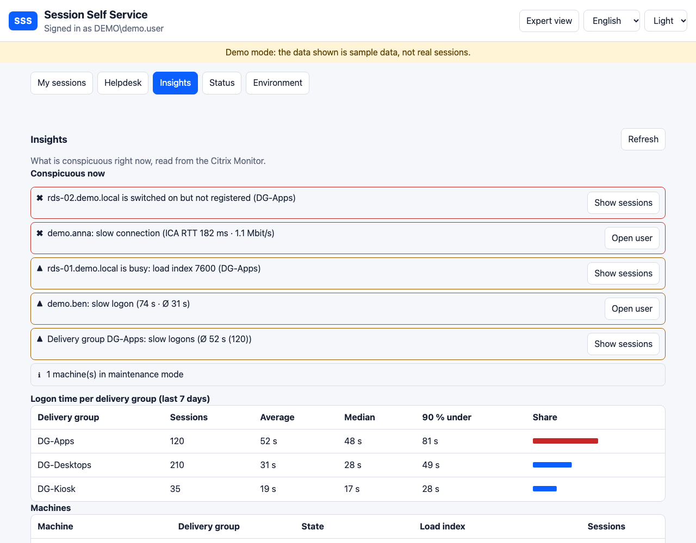

# Insights, cards and user history

[Deutsch](INSIGHTS.de.md)

## Insights tab (all helpdesk levels)

The **Insights** tab answers "what is conspicuous right now?" without opening a single session. It reads the Citrix Monitor and needs no extra setup. The result is cached for a minute.

**Conspicuous now** lists, most severe first (each with a symbol and text, not only a colour):

| Finding | When | Button |
|---|---|---|
| Slow connection | a live session has an ICA round-trip time or available bandwidth beyond the limits of `Sss:Quality` | Open user |
| Slow logon | a session of the last 24 hours logged on slower than `LogonWarnSeconds` **and** at least 1.5 times slower than its delivery group's average | Open user |
| Slow delivery group | the group's average logon time of the last 7 days is beyond the limit | Show sessions |
| Machine not registered | a machine is switched on but not registered with the Delivery Controller (not in maintenance) | Show sessions |
| Machine busy | the load index of a registered machine is beyond `LoadWarn` or `LoadCrit` | Show sessions |
| Maintenance | number of machines in maintenance mode (information) | |

*Open user* opens the user's sessions, where log off, message and the expert view are. *Show sessions* opens the helpdesk list filtered to that machine or delivery group.

**Logon time per delivery group** shows count, average, median and the time 90 % of the logons stay under (sessions of the last 7 days that have a logon duration). It is computed from the Monitor's session records, so it works even where the Monitor's own summary tables are empty.

**Machines** lists every VDA with a state (problem, busy, OK, maintenance, off), its load index and the number of sessions.

## Logon time against the delivery group

In the expert view of a session the helpdesk sees a line such as "Logon 38 s ▲ delivery group DG-Desktops: average 31 s, median 28 s, 90 % under 49 s". It tells whether this session (or user) is slow or the whole group is.

## History of a user

Above the sessions of the user the helpdesk sees the last 30 days in one line: number of sessions, average logon time (and the group's), connection failures and automatic reconnects. A frame in yellow or red marks users with many problems (five or more failures and reconnects, or a logon time clearly above the group's). The line uses the same permission as viewing the user's sessions and is cached for five minutes.

## Cards for users

A normal user (expert view off) sees the own sessions as **cards**: first one sentence on whether everything is fine, then per session its name, state, the two quality lights and the log-off button. The technical columns (delivery group, machine, start, duration, idle, client) are behind **Details**. The helpdesk and the expert view keep the dense table. The history period and CSV export now sit with the history.

## Data sources and limits

`Sessions`, `Users`, `Machines`, `LoadIndexes`, `ConnectionFailureLogs` and `SessionAutoReconnects` of the Monitor (see [DATA-SOURCES](DATA-SOURCES.md)). Nothing is stored by SSS. A farm with very many sessions is read up to `Sss:Citrix:Monitor:MaxPages` pages. A record set the site does not have simply leaves its part out.
