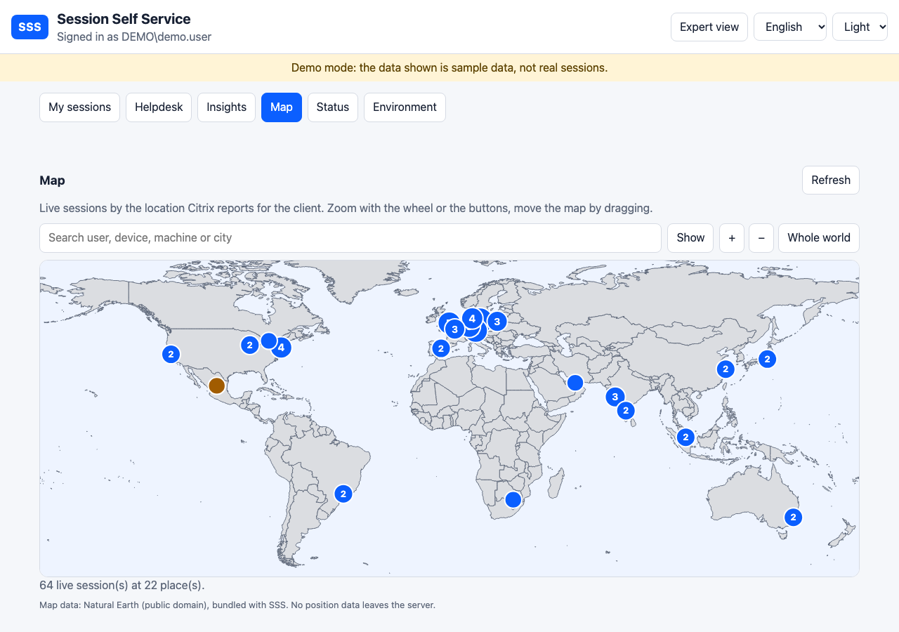

# Karte

[English](MAP.md)

Die **Karte** (alle Helpdesk-Stufen) zeigt alle Live-Sitzungen der Umgebung auf einer Weltkarte. Es ist keine Einrichtung nötig: Der Standort kommt aus dem Citrix Monitor (`ClientLocationCountry` und `ClientLocationCity` der Verbindung, dieselben Daten wie die Standorttabelle im Reiter Umgebung).

- **Zoomen und verschieben**: Mausrad, die Knöpfe + und −, oder die Tasten + − und die Pfeiltasten bei fokussierter Karte; zum Verschieben ziehen. *Ganze Welt* setzt die Ansicht zurück.
- **Orte**: ein Kreis je Ort mit der Zahl der Sitzungen. Weit genug hineingezoomt ist jede Sitzung ein eigener Punkt mit dem Benutzernamen. Ein Klick auf einen Ort listet seine Sitzungen (Benutzer, Gerät, Maschine, Bereitstellungsgruppe) mit einem Knopf *Benutzer öffnen*.
- **Suche**: Benutzer, Gerät, Maschine, Bereitstellungsgruppe oder Ort. Treffer werden rot, die übrigen Orte verblassen; die Trefferliste springt zu einer Sitzung, *Zeigen* zoomt zum ersten Treffer.
- **Ungefähre Positionen**: Die Position einer Stadt stammt aus einer mitgelieferten Liste mit rund 5.700 Orten. Eine Stadt, die nicht in der Liste steht, erscheint in der Mitte ihres Landes (orange, als ungefähr gekennzeichnet). Sitzungen ohne Land (interne Adressen, ältere Clients) lassen sich nicht platzieren und stehen unter der Karte.

## Datenschutz

Umrisse und Ortsliste sind in SSS enthalten (`wwwroot/geo/world.json`, abgeleitet von [Natural Earth](https://www.naturalearthdata.com/), gemeinfrei). Den Ort bestimmt der Browser selbst, daher **geht keine Adresse, kein Name und kein Standort an einen Kartendienst**, und die Karte funktioniert ohne Internetzugang. Die Client-Adresse gehört nicht zu den Daten der Karte. Die Daten werden wie die übrigen Insights aus dem Monitor gelesen (eine Minute zwischengespeichert) und enthalten Namen, deshalb sind sie auf die Helpdesk-Rollen beschränkt.
