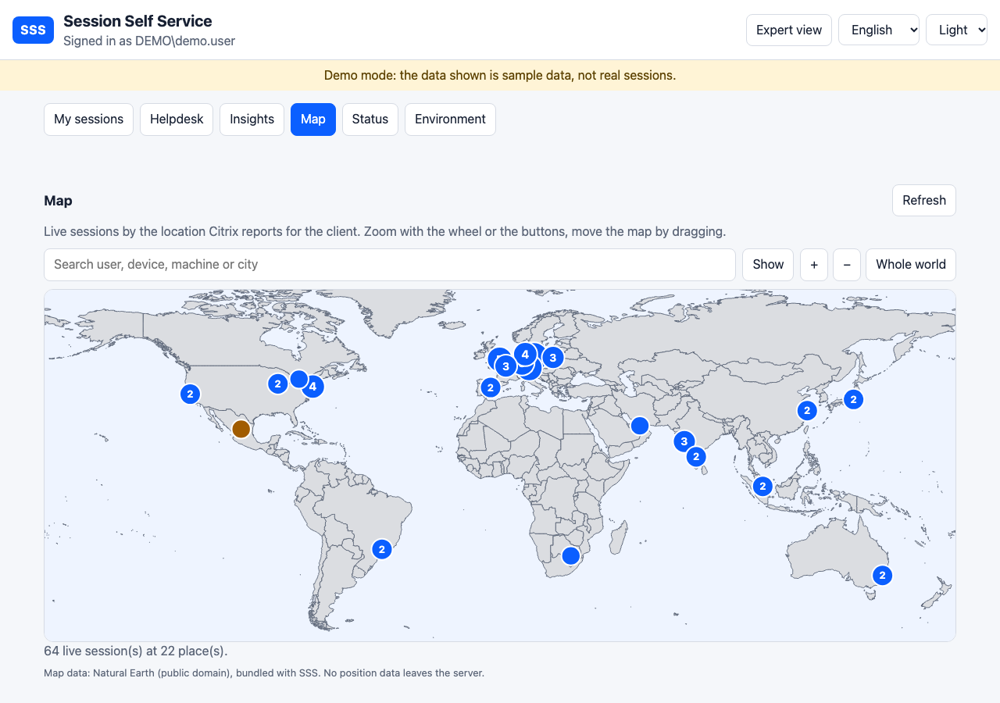

# Map tab

[Deutsch](MAP.de.md)

The **Map** tab (every helpdesk level) shows all live sessions of the site on a world map. It needs no setup: the location comes from the Citrix Monitor (`ClientLocationCountry` and `ClientLocationCity` of the connection, the same data as the location table of the Environment tab).

- **Zoom and move**: mouse wheel, the + and − buttons, or the keys + − and the arrow keys with the map focused; drag to move. *Whole world* resets the view.
- **Places**: a circle per place with the number of sessions. Zoomed in far enough, every session is its own dot and carries the user name. A click on a place lists its sessions (user, device, machine, delivery group) with an *Open user* button.
- **Search**: user, device, machine, delivery group or city. The matches turn red, the other places fade; the result list jumps to a session, *Show* zooms to the first match.
- **Approximate positions**: the position of a city is looked up in a bundled list of about 5,700 places. A city that is not in the list is shown in the middle of its country (orange, marked as approximate). Sessions without a country (internal addresses, older clients) cannot be placed and are listed under the map.

## Privacy

The outlines and the place list are bundled with SSS (`wwwroot/geo/world.json`, derived from [Natural Earth](https://www.naturalearthdata.com/), public domain). The browser finds the position itself, so **no address, name or location is sent to a map service**, and the map works without internet access. The client address is not part of the data the map receives. The data is read from the Monitor like the other Insights (cached for a minute) and shows names, so it is limited to the helpdesk roles.
