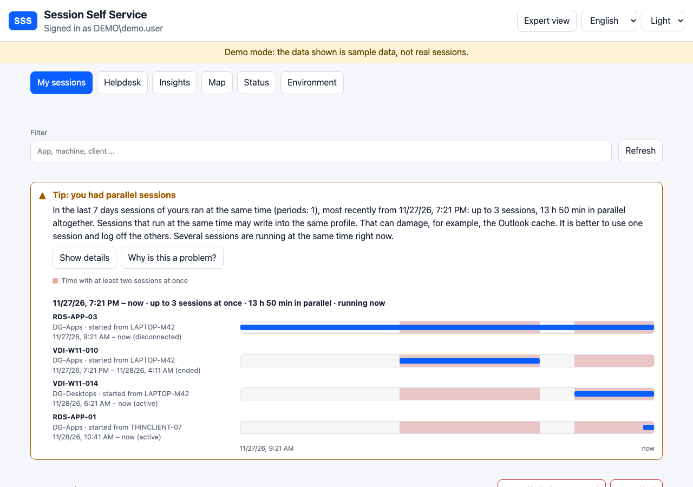

# Parallele Sitzungen

[English](PARALLEL.md)

Benutzer öffnen manchmal eine zweite Citrix-Sitzung, während die erste noch läuft. Das ist an sich in Ordnung, aber zwei Sitzungen, die gleichzeitig in **dasselbe Profil** schreiben, können Schaden anrichten. Ein typischer Fall mit einem Profil-Container wie FSLogix: Beide Sitzungen ändern den Outlook-Cache unabhängig voneinander. Die laufenden Sitzungen merken nichts; beim nächsten Anmelden meldet Outlook, dass eine alte Kopie des Caches verwendet wird und Daten nicht aktualisiert werden können. Andere Anwendungen, die ins Profil zurückschreiben, können ähnlich betroffen sein.

SSS weist dort darauf hin, wo man hinschaut, mit einer Erklärung und den Details, wenn man sie will.

## Wo es erscheint

- **Ansicht des Benutzers**: eine Tipp-Karte über den Sitzungen, in einfachen Worten, mit Knöpfen für die Details und für „Warum ist das ein Problem?".
- **Helpdesk**: dieselbe Karte nach Auswahl eines Benutzers, mit der Zahl der Zeiträume mit parallelen Sitzungen, dem längsten und dem Hinweis, ob gerade Sitzungen parallel laufen.
- **Details**: Sitzungen, die durch Überschneidungen zusammenhängen (A mit B, B mit C), bilden einen **Zeitraum** mit einer gemeinsamen Zeitachse: je Sitzung eine Zeile mit Maschine, Delivery Group, dem Gerät, von dem sie gestartet wurde, Beginn, Ende und Zustand. Hinterlegt sind die Zeiten, in denen mindestens zwei Sitzungen liefen; die Überschrift nennt die meisten gleichzeitigen Sitzungen und die gesamte parallele Zeit. Gezeigt werden die letzten 10 Zeiträume. (Die Insights-Liste zählt weiterhin Sitzungspaare.)
- **Insights-Tab**: eine Liste der Benutzer mit parallelen Sitzungen in den letzten Tagen, laufende zuerst. Der Helpdesk öffnet den Benutzer von dort.



## Wie es gefunden wird

Zwei Sitzungen desselben Benutzers überschneiden sich, wenn sich ihre Zeiten überschneiden. Eine Sitzung ohne Ende (laufend oder getrennt) zählt bis jetzt; eine **getrennte Sitzung zählt wie eine aktive**, weil sie das Profil offen hält und beim Abmelden zurückschreibt. Sitzungen in **derselben Delivery Group** werden als Tipp oder Warnung gezeigt (wahrscheinlich dasselbe Profil), Sitzungen in verschiedenen Gruppen als Hinweis.

SSS nutzt nur, was der Monitor ohnehin liefert: Start, Ende, Delivery Group, Maschine und Client jeder Sitzung. Es fragt keinen VDA, belastet ihn also nicht. SSS **weiß nicht**, welchen Profiltyp du einsetzt und ob zwei Sitzungen wirklich ein Profil teilen; das hängt von deiner Profilverwaltung ab. Der Text sagt das offen.

Grenzen: Verglichen werden nur Sitzungen im Zeitraum, und die Insights-Liste sieht nur Sitzungen, die **im** Zeitraum gestartet sind. Auch bei einem kurzen Zeitraum in der Sitzungsliste (zum Beispiel 1 Stunde) schaut diese Prüfung `Overlap:Days` Tage zurück.

## Einstellungen

| Einstellung | Standard | |
|---|---|---|
| `Sss:Overlap:Enabled` | `true` | Schaltet den Hinweis aus. |
| `Sss:Overlap:Days` | `7` | Tage zurück (1 bis 30). |
| `Sss:Overlap:MinMinutes` | `0` | Kürzere Überschneidungen ignorieren. `0` zeigt alle. |
| `Sss:Overlap:SameDeliveryGroupOnly` | `false` | Nur Sitzungen derselben Delivery Group zählen. |
| `Sss:Overlap:IgnoreDeliveryGroups` | `[]` | Gruppen, in denen Parallelnutzung unschädlich ist. |

Beispiel, eine Gruppe ohne Profilverwaltung ausnehmen:

```json
{ "Sss": { "Overlap": { "IgnoreDeliveryGroups": [ "Veröffentlichte Apps ohne Profil" ] } } }
```

Nach Änderung der Datei die Anwendung neu starten (Anwendungspool recyceln).

## Was man dagegen tut

Den Benutzer bitten, in einer Sitzung zu arbeiten und die andere abzumelden, oder die Zahl der Sitzungen je Benutzer begrenzen (Citrix-Richtlinie, oder eine Delivery Group je Profil). Ob Parallelnutzung überhaupt erlaubt ist, entscheidet deine Profilverwaltung (zum Beispiel die FSLogix-Einstellungen für mehrere Sitzungen).
