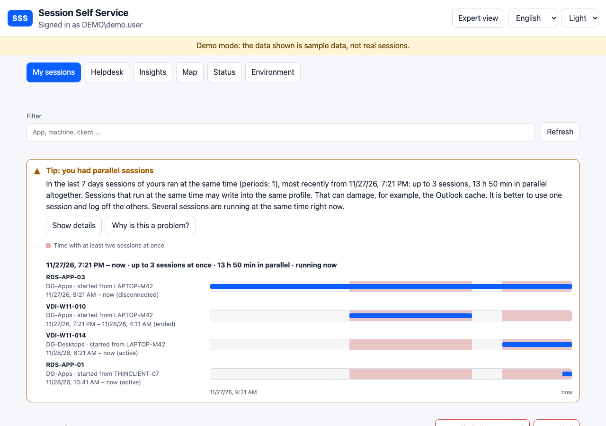

# Parallel sessions

[Deutsch](PARALLEL.de.md)

Users sometimes open a second Citrix session while the first one is still running. That is fine in itself, but two sessions that write into the **same profile** at the same time can do harm. A typical case with a profile container such as FSLogix: both sessions change the Outlook cache independently. The running sessions notice nothing; at the next logon Outlook reports that an old copy of the cache is used and that data cannot be updated. Other applications that write back to the profile can be affected in a similar way.

SSS points this out where people look, with an explanation and the details if they want them.

## Where it shows

- **User's view**: a tip card above the sessions, in plain words, with buttons for the details and for "Why is this a problem?".
- **Helpdesk**: the same card after selecting a user, with the number of periods with parallel sessions, the longest one and whether sessions run in parallel right now.
- **Details**: sessions that are connected by overlaps (A with B, B with C) form one **period** with one time axis: one row per session with machine, delivery group, the device it was started from, start, end and state. Shaded are the times in which at least two sessions ran; the heading names the most sessions at the same moment and the total parallel time. The latest 10 periods are shown. (The Insights list keeps counting pairs of sessions.)
- **Insights** tab: a list of the users with parallel sessions in the last days, running ones first. The helpdesk opens the user from there.



## How it is found

Two sessions of the same user overlap when their times overlap. A session without an end (running or disconnected) counts until now; a **disconnected session counts like an active one**, because it keeps the profile open and writes back when it is logged off. Sessions in the **same delivery group** are shown as a tip or warning (probably the same profile); sessions in different groups as a note.

SSS uses only what the Monitor delivers anyway: start, end, delivery group, machine and client of each session. It asks no VDA, so it adds no load there. It also **does not know** which profile type you use or whether two sessions really share a profile; that depends on your profile management. The text says so.

Limits: only sessions inside the period are compared, and the Insights list sees only sessions that **started** inside it. A short range in the session list (for example 1 hour) still looks back `Overlap:Days` days for this check.

## Settings

| Setting | Default | |
|---|---|---|
| `Sss:Overlap:Enabled` | `true` | Switches the hint off. |
| `Sss:Overlap:Days` | `7` | Days to look back (1 to 30). |
| `Sss:Overlap:MinMinutes` | `0` | Ignore overlaps shorter than this. `0` shows all. |
| `Sss:Overlap:SameDeliveryGroupOnly` | `false` | Count only sessions of the same delivery group. |
| `Sss:Overlap:IgnoreDeliveryGroups` | `[]` | Groups where parallel use is harmless. |

Example, ignoring a group without profile management:

```json
{ "Sss": { "Overlap": { "IgnoreDeliveryGroups": [ "Published apps without profile" ] } } }
```

Restart the application (recycle the app pool) after changing the file.

## What to do about it

Ask the user to work in one session and log the other off, or limit the number of sessions per user (Citrix policy, or by using one delivery group per profile). Whether parallel use is allowed at all is a decision for your profile management (for example the FSLogix settings for multiple sessions).
